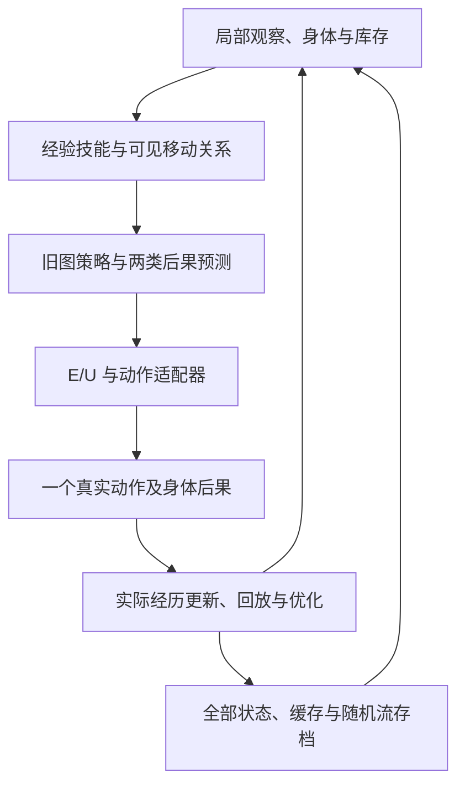

# 物欲当前完整体：全量整合验收

2026-10-13 · 当前主干 1.2.0 · 源码、机制、生命周期与可复现交付

**结论：当前版本通过工程完整性和可运行性验收，可以作为同一个体继续增加机制与开展实验。长期稳定生存仍未达成；历史所有备选机制也没有全部融合为一个算法。**

本轮按固定配置实际运行，没有只检查文件是否存在。没有发现需要修改冻结主干的整合错误。新增内容是验收工具、实际运行记录和交付说明，01–08 原始源码、当前决策算法及正式实验协议保持原样。

## 1. 这次实际跑了什么

| 验收项 | 实际范围 | 结果 |
|---|---|---|
| 原始来源完整性 | 300 个 Python、JavaScript 与协议文件，对照原始导入清单逐项核验 | 无缺失、无变化 |
| 原项目回归 | 01–08、旧整合版及四项后续研究，共 13 组、131 项测试 | 全部通过 |
| 当前统一主干回归 | 统一入口、Whole、关系学习，共 39 项测试 | 全部通过 |
| 公开运行配置 | 15 个入口，全部 153 种已注册模式与情境组合 | 全部通过 |
| 补充验证 | R10 其余 4 个模型初始化；R00/R10 各一条 5,120 步长生命 | 6 组工程检查通过；两条长生命均死亡 |
| 主运行总量 | 159 组，共 316,354 个主事件 | 无运行异常；完整保留逐组结果 |
| 中途保存与恢复 | 在真实运行中保存，累计核对 7,691 个续跑分支事件及完整最终状态 | 逐项相同 |
| 跨进程 CLI 续跑 | 1,173 步连续运行，对比 1,097 + 76 步分进程运行 | 事件文件、最终存档逐字节相同 |
| 旧存档显式迁移 | Whole 1.1 的 A/C，两种来源分别迁往五种 R 模式，共 10 条路径 | 全部可续跑，保存恢复均精确 |
| 当前运行来源锁 | 验收前后的 170 个主干及依赖来源项 | 完全一致 |

这 159 组是工程验收，不是额外的独立效果样本；恢复分支、迁移分支、时间步也不作为新的独立个体。它覆盖全部公开配置，不等于证明所有可能输入、所有代码分支或无限运行都不会失败。

### 各入口的实际运行范围

| 入口 | 配置数 | 每组范围 |
|---|---:|---|
| 01–08 | 8 | 各推进 256 个原生事件；保留各自宏动作、批次、旧检查点语义 |
| integrated | 4 | 各 1,536 步 |
| goals | 20 | 全部五变体 × 四情境，运行至原定义的完成或停止；共 66 个事件 |
| exploration | 2 | 各 1,728 次实际采集；原协议每步身体重置仍明确保留 |
| history | 2 | 各 2,400 步 |
| revision | 30 | 五方法 × 六情境，各 2,400 步 |
| workshop_bridge | 6 | 各 1,536 步 |
| whole | 81 | 九模式 × 九情境；native 各 1,536 步，其余各 2,560 步 |
| whole 补充 | 6 | 四组其他初始化各 2,560 步；两组长生命各 5,120 步 |

工程验收的固定种子为 1770100，额外长生命为 1770101；没有在看到生死结果后更换种子。旧阶段的 256 个原生事件是接续验收窗口，没有把它表述成重新执行全部旧论文式训练与统计研究。

## 2. 现在共同运行的主体

当前主体是 `WholeAgent`。一个世界、一个身体、一个库存、一套旧图状态和经验记忆、两类后果预测、真实经历回放、E/U、新动作学习以及可选移动关系，共享同一条绝对时间线。每次选择一个实际动作，反馈后才更新学习状态。



R10 读取实际移动学得的关系；R00 在后台学习但不让关系改变动作。R01/R11 另学习旧策略权重，RT 固定为 0.9。这些是同一主体中的实验开关。兼容默认入口仍为 `whole/A/native`；运行当前关系版本应明确选择 `--mode R10`。

### 实际共同工作的证据

以下来自本次固定种子 1770100、初始化 0、R10/r_combined 的完整 2,560 步运行，不是静态代码推测。

| 机制 | 本次实际活动 |
|---|---:|
| 关联与物品记忆更新 | 1,560 次 |
| 完成并学习的操作技能 | 507 次 |
| 神经后果学习 | 2,560 次 |
| 历史前缀回放更新 | 2,559 次 |
| 实际动作证据更新 | 2,560 次 |
| 局部证据修订 U | 3 次 |
| 动作适配器更新 | 80 次 |
| 实际移动关系观测 | 991 次 |

该个体存活至终点。保存点有 9 条未完成的动作学习样本；恢复后其缓存、优化器、身体、记忆、关系和随机流继续共同推进。旧图网络权重保持原定义的固定状态，未把它冒充在线更新的整个神经结构。

## 3. 1–8 和后续实验怎样进入当前系统

| 来源 | 已在当前主闭环中的部分 | 仍保留为独立实验或尚未融合的部分 |
|---|---|---|
| 01 价值记忆 | 经历影响后续行为的基础组织原则 | 原学习率门控与给定价值函数，没有机械移植为新价值形成器 |
| 02 工具与维护 | 身体成本、库存、前置物依赖 | 原 Q 表及宏动作控制器 |
| 03 循环感知 | 私有循环后果预测与在线学习 | 不同维度的旧权重与 Dyna 控制器 |
| 04A 前缀回放 | 从真实过去重算短前缀 | 不是完整一生的反向重放 |
| 04B 隐情境 | 原代码与统一生命周期可运行 | 专家路由、付费额外观测尚未进入 Whole |
| 05 个体经历 | 私有随机流、连续状态、实际历史回放 | 原复杂门控没有默认整体必要性证据 |
| 06 身体与后果 | 身体储量、学习后果与行动偏置 | 原目标池与身体付费回放尚未融合；计算成本没有从身体扣费 |
| 07 技能与依赖 | 在线关联、物品效应、实际完成的技能记忆 | 旧宏观规划器未作为隐藏教师接入 |
| 08 图动作与需要 | 旧图策略骨干、循环状态、身体与经验输入 | 旧图网络权重固定，保留其离线教师训练来源 |
| 目标形成研究 | 后果学习与给定身体调节准则的机制归位 | 没有证成新欲望、新目标内容或新评价标准 |
| 自主探索研究 | 真实经历采集可转交隔离评估，全部旧入口保留 | 原 BFS 探索器与每步身体重置不伪装成连续生命 |
| 持续经历研究 | 连续状态、预测先于反馈、精确保存续接 | 不混合不同身体坐标体系的分数 |
| 证据复验与修订 | E 的复验偏置、U 的按动作局部修订 | 复验偏置不等于经过校准的不确定性 |
| Whole 1.1 | 统一进展语义、动作学习、GRU/门控状态、优化器与未完成缓存 | 当前身体奖励与目标准则仍是设计给定 |
| 本轮关系实验 | 可见移动关系进入图特征、决策与实际隐状态推进；旧策略权重可独立开关 | 继承六节点、环形几何与启发式距离转换，不是自主发明世界结构 |

因此，“当前版本源码完整、当前主体运行完整”可以确认；“所有历史算法已无差别熔成一个系统”不成立。上述边界属于已有设计和研究边界，没有用文件聚集来替代机制融合。

## 4. 可行性与仍未达到的预期

本轮全量验收回答的是：当前系统能否加载所需代码和模型、各配置能否运行、机制是否实际共同更新、物理状态是否连续、存档是否完整、旧版本能否显式迁移。上述项目通过。

已有冻结正式实验回答有限情境下是否有效：在 128 个世界、两个固定初始化的组合挑战中，R10 相对 R00 的平均身体损失降低约 **65.46%**，存活从 **55/256** 提升到 **192/256**；世界配对差值为 −0.4830，95% 区间为 [−0.5484, −0.4192]。这是既有实验结果，不由这次固定种子验收重新估计。完整证据、恢复经过和解释边界见 `WUYU_Relation_Report_2026-10-12.md`。

尚未达到的部分也保留：

- 本次额外长生命中，R00 在第 2,495 次真实转移后死亡，R10 在第 2,530 次后死亡，随后均保持死亡吸收态到 5,120 步。验收通过表示状态正确，不表示生存成功。
- 既有正式长生命中，R10 的 5,120 步存活为 17/32，R00 为 5/32，仍有明显失败。
- R11 相对 R10 的附加收益尚未建立；RT 的简单固定权重是必要强对照。当前没有依据把“再加一层学习”自动视为进步。
- 偶发失败情境存在很小但可测的身体损失增加；关系遗忘与重新探索仍有代价。
- 新目标内容、自主评价标准、任意长依赖和无限稳定生存没有被当前实现或证明。

**下一步应从当前整体的死亡前因果链入手**：保留已有效的 R10 关系读取和 RT 对照，分析身体余量、前置物缺失、路线选择及恢复开销如何共同导致死亡，再设计一个能直接进入同一主闭环的最小改动。此次不为使验收“全活”而修改算法或筛选种子。

## 5. 合并后运行

本次源码分包是独立 ZIP，成员互不重叠；把所有分包解压到同一个父目录即可合成 `WUYU_Whole_2026-10-12/`。也可使用同批提供的 `merge_wuyu.py`，它会校验各包与每个成员后再合并。需要下载全部源码分包，不需要旧 Source 包。

包含全部原源码、当前代码、运行所需既有模型、迁移示例、研究摘要和本次完整验收记录。历史与关系实验的全部大型逐步原始轨迹属于独立证据数据集；它们不是启动、续跑、全量测试和本次验收所需的运行依赖，不混称为源码分包内容。

在合并后的根目录执行：

```bash
python3 -m pip install -r requirements.txt
python3 -B -m wuyu_unified verify-sources
python3 -B -m wuyu_unified list
python3 -B -m wuyu_unified run --profile whole --mode R10 --case r_combined --seed 1770100 --horizon 2560 --steps 768 --out runs/current_768
python3 -B -m wuyu_unified resume runs/current_768/state.wuyu --steps 1792 --out runs/current_final
```

`--out` 必须是尚不存在的目录。暂停不推进物理时间；续跑不清空未完成学习缓存；已经死亡的个体不会复活。运行需要 Python 3.12 或更新版本；本次实际环境为 Python 3.12.14、NumPy 2.3.5。跨硬件和数值库不承诺逐字节相同。

复跑验收：

```bash
python3 -B tools/run_original_tests.py
python3 -B -m unittest discover -s tests -v
python3 -B tools/verify_complete_system.py --out validation/my_full_acceptance --workers 4
python3 -B tools/verify_all_relation_migrations.py --out validation/my_migration_acceptance
```

## 6. 对照证据

- `validation/system_acceptance_2026-10-13/ALL_TESTS.json`：170 项本次实际测试及逐组日志。
- `validation/system_acceptance_2026-10-13/full/CONFIGURATIONS.json`：固定配置、种子、生命长度。
- `validation/system_acceptance_2026-10-13/full/ACCEPTANCE.json`：159 组检查的完整结果。
- `validation/system_acceptance_2026-10-13/full/runs/`：逐组结果、当前主体身体与动作记录、选定完整存档。
- `validation/system_acceptance_2026-10-13/full/CLI.json`：跨进程逐字节等价结果及执行命令。
- `validation/system_acceptance_2026-10-13/migrations/MIGRATIONS.json`：十种显式迁移路径的核对结果。
- 同批 `WUYU_Complete_Package_Verification_2026-10-13.json`：分包合并、文件校验及空目录复原后的运行核验。

全部结果的含义以实际测试范围为限，不能把工程通过直接升级成全部研究预期已实现。
