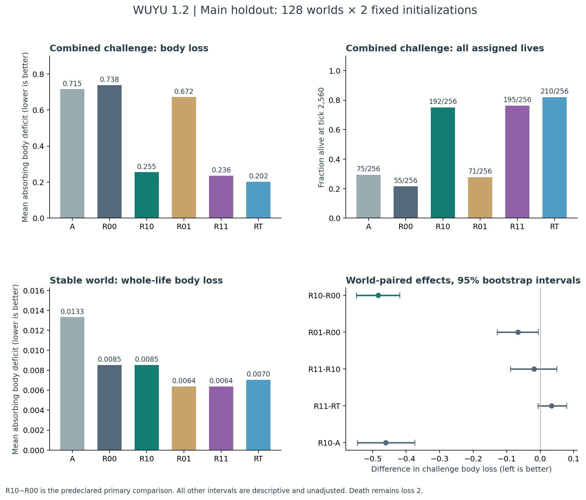
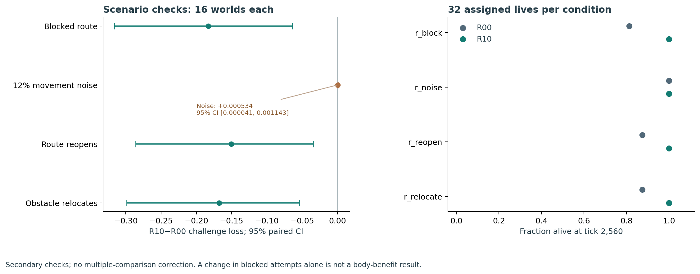
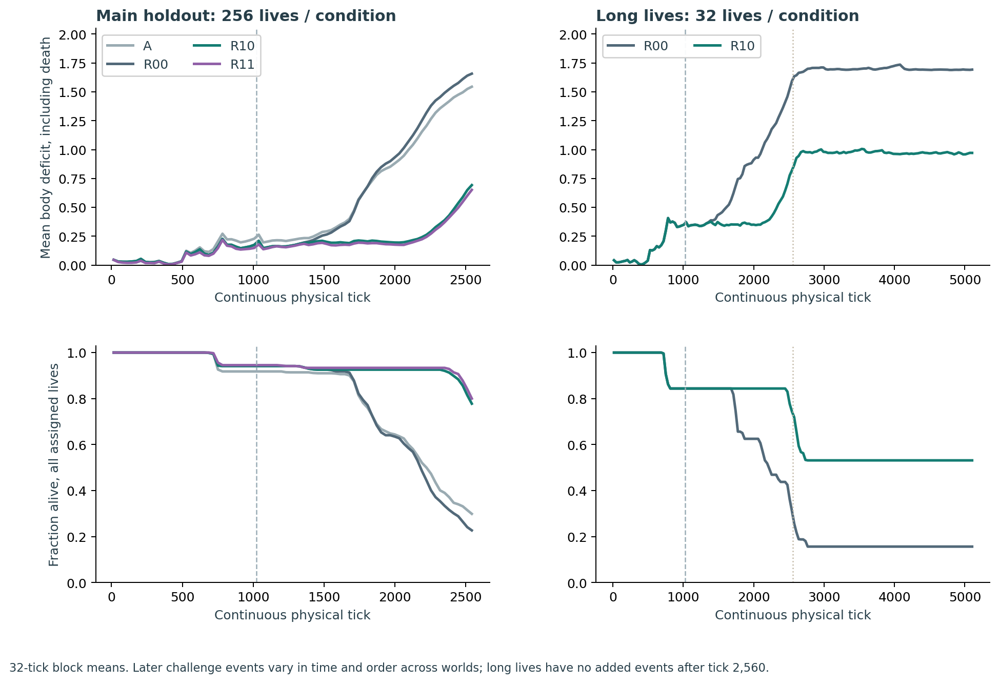

# 物欲完整体 1.2：可达关系、策略权重与连续生命

2026-10-12 实验冻结｜2026-10-13 证据恢复与交付｜固定样本验证和全量物理审计完成

**关系读取的身体收益通过了本轮预设标准。** 本轮把“真实移动经历 → 可更新关系 → 同一个体的行动 → 身体后果”接进已有主干，完成 3,904 条正式生命、10,158,080 次主生命转移。首要 R10−R00 为 **-0.483000，95% CI [-0.548411, -0.419226]**；相对于 R00 的平均损失变化为下降 65.46%（负值表示上升）。

建议把 R10 作为下一阶段明确选用的关系学习基线，继续在当前完整体内研究。默认 A 保留用于兼容和对照，R11 不因模块更多而自动成为主线。

## 完整体发生了什么变化

新机制直接运行在已有 WholeAgent 中，共用身体、库存、图网络、技能记忆、神经后果预测、真实回放、E/U 和动作出口；从开发阶段开始就是同一完整体，没有先做独立玩具代理再拼回。原 01–08 与后续项目的源码仍保留，未把所有历史模块宣称为每一步同时激活。

关系模块只读取可见的起点、动作和下一位置。六个位置与两个移动动作各保留一个下一位置分布，实际结果以 0.45 更新率写入。久未观察时以 256 步时间尺度向既有环形先验恢复；置信年龄、观测次数、预测前 Brier 误差和近期真实经历进入存档。

R1 把成功概率转换成沿两个原环方向的代价和：每条边采用 1/max(p,0.04)，再按原尺度除以 5、上限 2，替换节点特征第 28、29 列。同一编码同时进入旧图网络的动作预览、实际循环状态推进和动作适配器，避免内部使用两套不同地图。六节点身份、环形几何、衰减规则和代价转换是设计先验；本轮没有从零学出空间，也没有实现代理自主发明的规划算法。

这里借用固定成功率、独立重试下的 1/p 形式构造启发式代价；实际封路、证据衰减和截断不满足这些条件，不能把它当作准确的最优旅行时间。旧距离范围为 [0,1]，新代价允许到 2，继承网络会接触原距离范围之外的值，原模型对这些值的反应并没有预先得到保证。

另一个独立因素调节旧组合策略的影响：从 softmax(log(base)+residual) 改为 softmax(tau·log(base)+residual)。G1 的 tau 由同一 GRU 的新增输出学习，来自真实身体奖励，初值 0.9。RT 固定 tau=0.9，G0 固定为 1。初始降温本身就改变动作概率，不是初次行动前已经学到的能力；tau 也不能自动称为经过校准的可信度。

| 条件 | 关系读取 | 旧策略权重 | 用途 |
|---|---|---|---|
| A | 关 | 原策略 | 兼容的完整基线 |
| R00 | 关，仍后台学习 | 1 | 旧 C 的普通 GRU 对照 |
| R10 | 开 | 1 | 单独检验关系读取 |
| R01 | 关，仍后台学习 | 学习，初值 0.9 | 单独检验权重学习 |
| R11 | 开 | 学习，初值 0.9 | 两因素共同开启 |
| RT | 开 | 固定 0.9 | 排查收益是否来自简单温度改变 |

五种 R 条件均分配 22,515 个动作适配器参数，输入仍为 378 维、普通 GRU 状态仍为 16 维。关闭门的条件不使用新增门参数，因此相同分配数量不等于有效容量相同。A 不配置动作适配器。旧图策略继承既有训练史，不能把整个系统说成从零自主形成；本轮在线没有新增教师动作、隐藏路线、子目标奖励或模拟经历回填。

## 冻结方案与首要结果

先完成两轮开发，共 480 条生命、12 个独立世界。算法和超参数没有在两轮之间修改。R10−R00 的挑战损失差分别为 −0.243430、−0.121477；两轮合并的世界配对标准差为 0.145190。为避免把小开发样本的方差当成精确事实，规划时乘 1.25 得到 0.181488。针对本轮最小有用绝对下降 0.05，正态近似 80% 功效需要约 104 个世界，正式固定为 128。0.05 是本轮在正式成绩之前确定的门槛，不沿用上一轮的 0.01。

开发中 R11 相对 RT 的方向反转，表现不稳定。因此在任何正式成绩出现前，将 **R10−R00** 指定为首要比较，权重学习保留为独立受检因素。正式三个协议一起冻结，没有依据正式结果再调参、挑世界或延长到显著。

| 组别 | 世界种子 | 独立世界 | 每条生命步数 | 生命数 |
|---|---|---:|---:|---:|
| 主验证 | 1600000–1600127 | 128 | 2560 | 3072 |
| 辅助情境 | 1601000–1601015 | 16 | 2560 | 768 |
| 长生命 | 1602000–1602015 | 16 | 5120 | 64 |

每个世界交叉两个固定的既有模型初始化。统计先在世界内平均两次初始化，再对世界做 10,000 次配对 bootstrap；时间步、分支和固定初始化不冒充独立世界。主指标为 t=1024..2559 的平均身体匮乏，死亡以后固定损失 2，越低越好。所有早死、未触发事件和未完成角色经历的个体都纳入。

| 条件 | 组合挑战损失 | 最终存活 | 稳定全生命损失 | 稳定存活 |
|---|---:|---:|---:|---:|
| A：完整基线 | 0.715369 | 75/256 | 0.013320 | 256/256 |
| R00：C 对照，关系不读 | 0.737887 | 55/256 | 0.008521 | 256/256 |
| R10：关系读取 | 0.254887 | 192/256 | 0.008521 | 256/256 |
| R01：只学习旧策略权重 | 0.671748 | 71/256 | 0.006371 | 256/256 |
| R11：关系＋权重学习 | 0.235868 | 195/256 | 0.006371 | 256/256 |
| RT：关系＋固定 0.9 | 0.201907 | 210/256 | 0.007041 | 256/256 |

首要差值 **-0.483000，95% CI [-0.548411, -0.419226]**。预定通过标准同时要求点估计 ≤−0.05、95% 区间上限小于 0，以及稳定能力保护条件。当前点估计门槛：通过；区间门槛：通过；稳定保护：通过。

正式世界除新种子外，还按既有 holdout 规则改变身体轴与依赖令牌的组合映射，不能把开发与正式样本视为完全相同的生成分布。本轮实际配对标准差为 0.373267，高于规划用的 0.181488；开发样本的功效估计不构成实际精度保证。主要收益仍由完整正式区间判断，不能把次级区间跨零解释为精确证明没有作用。

稳定全生命损失 R10−R00 为 +0.000000，95% CI [+0.000000, +0.000000]，保护上限为 +0.02；存活率差为 +0.000000，95% CI [+0.000000, +0.000000]，保护下限为 −0.02。稳定世界中关系从未遭遇移动矛盾，R00 与 R10 的编码相同，保护通过应作限定解释，不能推出所有历史任务都等效。

组合挑战的最终存活率差 R10−R00 为 +0.535156，95% CI [+0.460938, +0.609375]。这是次级结果，与主损失共同阅读。

## 学习旧策略权重是否值得保留

| 比较 | 检验含义 | 挑战损失差 |
|---|---|---|
| R01-R00 | 无关系读取时，权重学习的差异 | -0.066139，95% CI [-0.129078, -0.005773] |
| R11-R10 | 有关系读取时，权重学习的差异 | -0.019019，95% CI [-0.089079, +0.049113] |
| R11-RT | 学习权重相对固定温度 | +0.033961，95% CI [-0.007336, +0.079042] |
| interaction | 两因素交互 | +0.047120，95% CI [+0.003311, +0.090562] |
| R10-A | 关系候选相对原完整基线 | -0.460483，95% CI [-0.545458, -0.374588] |

这些次级区间没有多重校正，不能根据排序把最低均值直接宣布为新赢家。R01−R00 与 R11−R10 分别检验有无关系读取时的权重作用；R11−RT 才能帮助区分学习权重与简单固定温度。两因素交互不等于“两个模块都更强”。不因 R11 结构更复杂就优先推广。

本轮有关系读取时，R11 相对 R10 的损失区间跨零；相对固定温度 RT 也未确立损失优势。RT 的平均挑战成绩更低，适合作为下一轮保留的强对照；这仍属于次级发现。R01 对 R00 的方向支持权重调节可能有用，但不能把该效果不加区分地外推到已具备关系读取的主体。

RT−R10 的挑战损失差为 -0.052980，95% CI [-0.123187, +0.015612]，最终存活率差为 +0.070312，95% CI [+0.019531, +0.121094]。这给出了保留 RT 的具体理由，也不把事后最好的存活排序替代预先指定的主指标。

## 是否只是少撞墙，而没有改善生存

所有受阻次数只统计动作前仍存活的时刻。分母中的 256 条生命始终保留；另给出按实际移动次数合并的受阻比例，并一起报告总存活步数、真正遇到矛盾的个体数和死亡时点。

| 条件 | 每生命结构受阻 | 每百次活体移动受阻 | 实际遇到结构矛盾 | 平均存活步数 | 两类依赖角色实际经历 | 通路事件前 / 当刻死亡 |
|---|---:|---:|---:|---:|---:|---:|
| A | 275.51 | 36.52% | 232/256 | 2094.0 | 220/256 | 22 / 1 |
| R00 | 311.06 | 38.90% | 236/256 | 2088.1 | 226/256 | 17 / 1 |
| R10 | 18.85 | 2.51% | 236/256 | 2421.4 | 226/256 | 17 / 1 |
| R01 | 308.83 | 36.33% | 239/256 | 2138.1 | 232/256 | 16 / 1 |
| R11 | 20.46 | 2.57% | 239/256 | 2435.3 | 232/256 | 16 / 1 |
| RT | 20.31 | 2.56% | 243/256 | 2461.7 | 228/256 | 13 / 0 |

受阻下降本身不证明学会计划，也不能排除回避或经历分布改变。身体损失是整体现实后果的评价，关系干预是通道实际作用的检查；两者分开判断。依赖课程只保证出现机会，不保证每个个体真正取得经历。没有因缺少经历或提前死亡排除样本。

事件在物理转移结束时应用，因此世界死亡时点为原始 death_tick+1。表中将严格早于通路事件和恰好在事件当刻死亡分开；后者可能包含同期身体冲击，不能全部说成早在事件之前已经死亡。冻结原始字段 death_before_route_change 实际合计这两类，原记录保留，主体损失和存活分析不变。

R10 仍有 64 条生命死亡，其中 18 条发生在通路事件之前或当刻，新通路信息尚无机会进入后续行动；另有 46 条在之后死亡。它还平均发出 41.60 次缺少前置物的取物请求。关系改善并没有消除所有依赖与身体维持问题，仅凭死亡时点不能认定剩余失败的唯一原因。

平均移动 Brier 误差也不能直接跨模式解释为校准排名：R0 往往反复访问同一失败边，R1 会改变访问分布，两者接受的查询不同。这里主要依据全体身体指标和受控内容干预判断功能效果。

## 封路、噪声、重开与障碍换位

辅助情境使用另一组 16 个世界，每条件 32 条生命。它们检查同一算法在不同变化下的行为，属于有限精度的次级验证。

| 情境 | R00 损失 | R10 损失 | R10−R00 | 存活 R00 → R10 |
|---|---:|---:|---|---|
| 持续封路 | 0.189403 | 0.006458 | -0.182945，95% CI [-0.316599, -0.063885] | 26/32 → 32/32 |
| 12% 偶发失败 | 0.005036 | 0.005571 | +0.000534，95% CI [+0.000041, +0.001143] | 32/32 → 32/32 |
| 封路后重开 | 0.156617 | 0.006052 | -0.150565，95% CI [-0.286140, -0.034089] | 28/32 → 32/32 |
| 障碍换位 | 0.174411 | 0.006766 | -0.167645，95% CI [-0.298946, -0.054256] | 28/32 → 32/32 |

道路重开特别检查设计中的“陈旧证据逐渐回到可通行先验”是否允许再次尝试。以下延迟只在确实重新跨过旧封路边的个体中统计；这个条件分母不能替代全体身体指标。

| 条件 | 重开时仍有存活行为 | 实际重新跨过旧边 | 首次跨越延迟中位数，步 |
|---|---:|---:|---:|
| A | 30/32 | 21/32 | 98.0（n=21） |
| R00 | 28/32 | 27/32 | 30.0（n=27） |
| R10 | 32/32 | 32/32 | 57.5（n=32） |
| R01 | 31/32 | 31/32 | 22.0（n=31） |
| R11 | 32/32 | 32/32 | 73.5（n=32） |
| RT | 32/32 | 31/32 | 49.0（n=31） |

本机制把偶发失败与结构封路都作为实际位置结果更新，没有显式潜在原因分类器。12% 噪声条件由世界种子和时间决定，独立于动作抽样随机流；环境事件标记只供评价使用，不输入决策器。

噪声条件中 R10 的身体损失略高，绝对差较小，且属于未校正的次级比较。这是当前机制的明确代价，不能归纳为对所有不确定环境都更好。重开时 R10 的全体存活较高，但条件跨越延迟也更长，不能据此说它更快发现道路已经恢复。

## 对关系内容做直接干预

预先指定的诊断世界中，某个有向位置第三次实际受阻且个体仍活着时复制完整状态。四条分支分别保留、将相关边的关系内容恢复为原旧内容、等幅扰动另一条边、扰动后精确恢复。只改关系分布，保留观测数、时间、身体、其余知识和随机流。各分支都冻结动作参数学习率，其他学习照常进行；父生命不接收分支经历。

正式共触发 106 个状态检查点、424 条 96 步分支、40,704 次分支转移。106 个保存的精确恢复轨迹全部与保留分支逐项相同，父状态未改变。未触发的生命保留在主研究分母中。

对照实际选择的是另一位置的有向关系，其中 12 个恰好为同一物理边的反方向，0 个未能找到可用匹配。它不保证是语义无关的另一条物理道路，不能当作严格的目标内容选择性对照。

| 组别/情境/模式 | 检查点 | 相关回退的首次概率总变差 | 共同存活期动作改变的检查点 | 相关回退的损失差 | 另一边扰动的损失差 |
|---|---:|---:|---:|---:|---:|
| 主验证/r_combined/R10 | 23 | 0.656494 | 23/23 | -0.001930 | +0.006906 |
| 主验证/r_combined/R11 | 22 | 0.627767 | 21/22 | +0.003963 | +0.000641 |
| 辅助情境/r_block/R10 | 15 | 0.351805 | 15/15 | +0.001420 | +0.000497 |
| 辅助情境/r_block/R11 | 16 | 0.249414 | 15/16 | +0.001241 | +0.002049 |
| 辅助情境/r_reopen/R10 | 15 | 0.351805 | 15/15 | +0.001420 | +0.000497 |
| 辅助情境/r_reopen/R11 | 15 | 0.254993 | 14/15 | +0.001324 | +0.002084 |

正损失差表示干预后变差，负值表示干预后更好。首次概率变化支持关系内容实际进入行动；后续动作变化说明影响可以传播，但不自动证明其必要性或统一收益。六节点环上另一条边仍可能影响替代路线，因此等幅不等于功能无关；诊断只在达到第三次受阻的状态触发，也不能代表所有个体。分支不作为额外独立样本，未识别或声称存在语义明确的“目标向量”。

关系本身在诊断分支仍会继续从新经历更新，被回退的知识可能很快重新学到。因此一次性回退后的 96 步身体差异不是持续关闭读取的必要性检验。全生命 R10−R00 与短分支结果估计的对象不同，应同时保留，不能用其中一个替换另一个。

## 同一个体活得更久以后

另取 16 个新世界，R00/R10 各 32 条生命，连续运行 5,120 步。没有在 2,560 步重置身体、网络、知识、缓存或随机流，也不复活死亡个体。后半段继续承受既有世界改变；没有新增更晚事件，不能把它解释为任意长期开放环境能力。

| 条件 | t=1024..2559 损失 | t=2560..5119 损失 | 2560 步存活 | 5120 步存活 |
|---|---:|---:|---:|---:|
| R00 | 0.773116 | 1.696007 | 9/32 | 5/32 |
| R10 | 0.406433 | 0.972971 | 23/32 | 17/32 |

同一长期样本的前段 R10−R00 为 -0.366683，95% CI [-0.566496, -0.185751]；后段为 -0.723035，95% CI [-1.126507, -0.358250]。每个窗口始终包括所有 32 条分配生命，提前死亡一直记为 2，不只选择幸存者。

图使用非重叠 32 步均值，死亡一直计入。组合事件时点抖动、通路和需要中断的顺序可变，因此全体时间均值不应被解读成每个个体在同一时刻遭遇同一变化。

## 迁移、验证与交付

39 项当前主干测试通过，覆盖门输出梯度有限差分、R00 对旧 C 的一致性、关系更新与遗忘、隐藏世界状态隔离、图编码一致性、死亡吸收和跨未完成学习缓存的存档接续。另核对 300 个继承 Python/JavaScript 源码及协议哈希，全部保持一致。上一轮曾通过的历史 131 项测试没有在本轮重新执行，不重复充当本轮新增测试。

本轮全部正式 3,904 条生命逐步重放，核验 10,158,080 次实际转移：原始文件与数组 SHA256、观察、身体冲击、真实目标、死亡、关系概率更新与次数，以及每条生命的汇总值均通过。两轮开发 480 条生命、1,228,800 次主转移也分别通过同类审计。完整性检查覆盖全部分配生命，未选择性删除失败记录。

审计从保存的原始动作重新运行同一套世界与关系实现，并从轨迹重算汇总；它验证记录一致性和可重放性，不是另一套独立物理模型对全部机制正确性的证明。关键语义另由有针对性的单元测试检查。

交付前临时工作目录跨日重置，已保存的完整主干和主实验检查点用于恢复。3,953 条生命的原摘要和轨迹哈希仍在；其中 3342 条通过原冻结代码复算，完整摘要除运行耗时外逐项一致；另 611 条按原始完整文件 SHA256 复制同一份已验证字节。其余 431 条沿原冻结协议、原种子恢复；它们没有留存可作逐条比对的原摘要。所有 4,384 条恢复后的开发与正式生命再次进行全量物理审计。恢复不是新增独立样本，不能增加证据强度或样本量。完整逐条恢复记录见各队列的 RECOVERY_COMPLETE_2026-10-13.json，来源说明见 docs/RELATION_RECOVERY_2026-10-13.md。

用冻结 Whole 1.1 的真实 C 个体推进到 t=1097，保留 9 个尚未完成更新的学习样本，再显式迁移到 R00/R10。身体、库存、旧技能、神经状态、随机流和 C 动作优化器保留；利用保留的 37 次真实移动重建近期关系。R00 的随后 64 步动作与身体结果和冻结旧版逐项相同，概率误差 ≤1e−13；R00/R10 各自保存后恢复的 64 步事件均完全相同。近期关系重建不等于完整历史无损，A 升级时也需新建动作适配器。

源码包含所有原项目及运行所需既有模型、当前主干、测试、协议、分析、审计、迁移与复现工具。Data 分包保存全部本轮开发/正式原始轨迹、诊断分支和相关存档。既往实验原始大数据保留在已有历史包，不冒充本轮重复执行。包分布清单与 SHA256 用于完整性验证。

当前可运行入口和完整命令见 `README.md`；关系机制见 `docs/RELATION_MECHANISMS.md`；样本选择见 `docs/RELATION_DEVELOPMENT_DECISION.md`。正式证据目录为 `experiments/relation_holdout_main`、`relation_holdout_scenarios`、`relation_holdout_long`。整体汇总见 `experiments/relation_validation/evidence_readout.json`。

## 结论边界与下一步

建议把 R10 作为下一阶段明确选用的关系学习基线，继续在当前完整体内研究。默认 A 保留用于兼容和对照，R11 不因模块更多而自动成为主线。

这轮能回答的是：真实可见移动结果形成的关系内容，是否改变完整体行动并在给定挑战中改善身体后果。它不能据此证明新欲望、新价值、人格、意识或独立形成的目标结构。身体评价、原几何与更新规则仍是给定的；模型初始化只覆盖两个既有版本；辅助和长期世界只有 16 个，次级区间未经多重校正。

后续继续从当前完整体出发，优先解释正式数据中的剩余失败，再决定是否补充新机制。需要把“暂时失败还是关系失效”“多久值得复验”“依赖知识是否进入连续行动”拆成可观察的假设；不能在本轮固定测试集上反复调参后再把改善当作新验证。未得到证据支持的权重调节保留为开关，不靠增加模块数量替代实验判断。

下一轮同时保留 R10 和 RT，并在新的世界里分别检验开发映射与正式映射，区分机制作用和环境组合差异。先定位剩余失败，再冻结一项主要改动和首要比较；整合主体、旧能力保护、长期身体后果与数据留存继续作为同一实验流程。

## 辅助情境全条件结果

| 情境 | 条件 | 挑战身体损失 | 最终存活 | 每生命结构受阻 |
|---|---|---:|---:|---:|
| 持续封路 | A | 0.084277 | 30/32 | 83.19 |
| 持续封路 | R00 | 0.189403 | 26/32 | 245.88 |
| 持续封路 | R10 | 0.006458 | 32/32 | 27.06 |
| 持续封路 | R01 | 0.057037 | 31/32 | 238.41 |
| 持续封路 | R11 | 0.004398 | 32/32 | 35.66 |
| 持续封路 | RT | 0.006247 | 32/32 | 30.00 |
| 12% 偶发失败 | A | 0.014861 | 32/32 | 0.00 |
| 12% 偶发失败 | R00 | 0.005036 | 32/32 | 0.00 |
| 12% 偶发失败 | R10 | 0.005571 | 32/32 | 0.00 |
| 12% 偶发失败 | R01 | 0.002837 | 32/32 | 0.00 |
| 12% 偶发失败 | R11 | 0.003280 | 32/32 | 0.00 |
| 12% 偶发失败 | RT | 0.004506 | 32/32 | 0.00 |
| 封路后重开 | A | 0.082757 | 30/32 | 59.16 |
| 封路后重开 | R00 | 0.156617 | 28/32 | 157.25 |
| 封路后重开 | R10 | 0.006052 | 32/32 | 16.50 |
| 封路后重开 | R01 | 0.050335 | 31/32 | 178.78 |
| 封路后重开 | R11 | 0.004075 | 32/32 | 23.12 |
| 封路后重开 | RT | 0.005848 | 32/32 | 17.16 |
| 障碍换位 | A | 0.092030 | 30/32 | 126.56 |
| 障碍换位 | R00 | 0.174411 | 28/32 | 275.22 |
| 障碍换位 | R10 | 0.006766 | 32/32 | 28.84 |
| 障碍换位 | R01 | 0.063862 | 31/32 | 282.91 |
| 障碍换位 | R11 | 0.004650 | 32/32 | 40.16 |
| 障碍换位 | RT | 0.006558 | 32/32 | 30.34 |

## 冻结协议摘要

主验证：`159d05c2d25d51977842dc45570687f243d42a126fb94c5f0b0eb0b7e8fef134`。

辅助情境：`054965a8ffa0e8e9749dfdd46168e57cb064f8467552355341bc3eaa05a3514b`。

长生命：`e537ec7edf3f5120045462db642a2722eb6f64cd7cc346203fb837b6755a67c5`。
