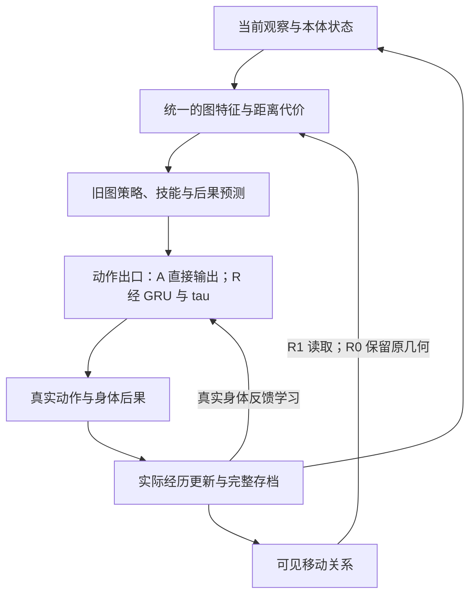

# 完整体 1.2：移动关系与旧策略影响

本轮在 WholeAgent 的原有生命周期中增加两个可独立关闭的因素。身体、库存、旧图网络、技能、神经后果预测、真实回放、E/U、动作学习和原始动作成本继续共同运行。默认模式仍为 A，研究入口为 R00/R10/R01/R11/RT。

图中的反馈都来自同一个体的实际经历。更新后身体、库存、记忆、关系、动作优化器和随机流共同进入下一步；暂停与恢复保持这一连续状态。图不表示所有旧项目入口同时执行，具体旧技能和状态仍以主干代码中的调用为准。

## 关系从哪里来，怎样进入行动

MovementRelations 只读取可见的起点、动作和下一位置。它对六个位置、两个移动动作分别保留一个六分类转移分布，使用近期指数更新，并在证据陈旧时逐渐回到已声明的原环形先验。观测数、最近观测时间、预测前的 Brier 误差和真实经历索引进入存档。

初始六节点身份、左右移动的环形几何是继承先验。未知边初始按原几何可通行估计；是否有观测支持另用 count 区分。这里没有从无先验中学出空间。

R1 借用独立重试的 1/p 形式构造移动代价，再按旧尺度除以 5、上限为 2，替换节点特征第 28、29 列。具体是 1/max(p,0.04) 的边代价，沿两个既有环方向分别求和。只有成功率固定、尝试独立等假设满足时，未截断的 1/p 才有相应等待次数解释；封路、遗忘与上限截断不满足这些条件，所以这里是启发式代价，不能称为准确的最优旅行时间。这是公开设计的特征转换，不是代理自主发明的规划算法，也没有调用真实世界地图。

旧距离输入处于 [0,1]，新代价允许到 2；继承图网络因而可能接收到超过原距离范围的值。这是可检验的表示变化与潜在迁移限制，不能把原模型对新值的反应先验视为可靠推理。

新表示同时用于旧图网络的动作预测、实际旧循环状态推进和动作适配器输入。避免预览时使用新地图、执行时仍使用旧地图的内部不一致。原始 source_projects 全部保持不变。

R0 也在后台根据自己的实际轨迹学习关系，但不让其影响动作，提供成本和数据记录上的参照。

Brier 误差计算在各个体自己实际选择的移动上。不同条件会访问不同位置、重复失败不同次数，因此跨条件的平均 Brier 不能直接当成同一查询分布下的校准优劣；主要整体判断仍看全部分配生命的身体结果。

证据衰减参数是设计假设：久未复验后向原可通行先验恢复，便于再次探查。这不是已校准的不确定性概率。道路重开和偶发失败条件专门检验该假设的收益与代价。

## 旧策略怎样被调节

原概率形式是 softmax(log(base)+r)，每个 r 在 (−2,2) 内。

G1 使用 softmax(tau*log(base)+r)，tau 由同一动作适配器的新输出经 sigmoid 得到，并从真实身体奖励学习。默认初始 tau=0.9；它在首次动作前就改变原策略尖锐程度，不能把初始差异算成个体已经学得的能力。现有 KL 仍相对于原 base，梯度包含 tau 对七个动作分布的影响。

输入维数仍为 378，采用原来的 16 维普通 GRU。动作修正七维、价值一维，另增加旧策略权重一维。五种 R 条件均分配 22,515 个参数；关闭门的条件中，新增门参数不实际参与学习。分配参数相同不代表有效计算容量相同。A 无动作适配器。

RT 读取关系，但 tau 固定为 0.9，作为简单温度对照。两轮开发和三个正式协议均使用该值，没有在正式结果后修改。

G 的变化尚不能被称为可靠性校准：它是从身体后果学得的权重，是否在证据失效时恰当变化是结果问题。

## 连续环境

全部使用原七个动作与身体动力学。r_stable 为稳定保护条件；r_block 持续封路；r_noise 有 12% 的按世界种子和时间索引的偶发移动失败；r_reopen 封路后重开；r_relocate 原障碍撤除并在另一处出现；r_combined 保留依赖、配方变化、需要中断、收益消失，改变事件时点，并随机交换通路事件与需要中断的先后。

外生噪声与行动随机流分离。路线标记、事件时点和正确替代路线仅在世界与评估器中，代理决策只读取普通观察及本体状态。世界和本体都完整存档。

## 诊断和边界

预定诊断世界中，在同一有向位置第三次实际受阻后复制完整状态。比较保留、相关关系恢复成旧内容、等幅扰动另一条边，以及精确恢复。固定动作参数学习率，其他经历学习在各分支照常发生；父生命不接收分支反馈。

“另一条边”在实现中准确指另一位置的有向移动关系，可能恰好是同一物理边的反方向，也可能影响替代路线。因此等幅对照不保证功能无关或语义不同。报告首次动作分布、共同存活期间动作变化、身体后果，以及反向同边和未找到匹配的实际数量，并保留未触发检查点者。精确恢复属于实现验证，不独立证明机制价值。

原有身体奖励未改。没有新教师动作、隐蔽子目标奖励、全知路线搜索或模拟经历回填。本轮检验真实经历对环境关系和动作的作用，不自行认证目标、价值或人格形成。
