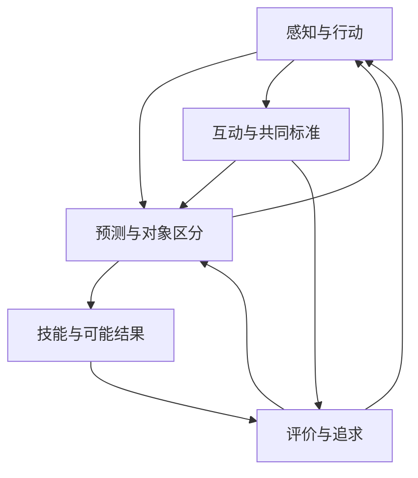

**物欲：人的形成与数字个体的理论工作底稿**

日期：2026-10-11｜状态：第二次修订，继续开放｜本次工作：提出候选初始条件、具体形成机制与发展案例对照

第一次修订取消将“在乎怎样形成”作为下一步唯一重点的安排，同时展开世界理解、行动协调、发展条件和个体连续性。第二次修订进一步给出起始假设、具体变化方式、各机制的依赖与可区分的解释。文件修订次数不代表物欲项目的阶段编号。

本稿承接“面向最终的物欲，由物理欲望形成的人”这一目标，以及“目前理论仍不完整，应先继续补全”的要求。它整理研究对象、概念、形成关系、竞争解释和未解问题。它没有完成数字生命、意识或人的制造理论，也不以既有代码或实验结果作为这些问题已经解决的凭据。

本稿的中心判断是：物欲需要解释一个个体怎样在具体存在条件、活动、经历、关系与文化中形成，又怎样理解、评价和改变自己。欲望在其中的地位，需要论证；不能凭项目名称预定它能够解释一切。

**阅读时先区分四种陈述。**

【研究依据】指下文所引用论文支持的有限事实或区分，不表示所有学界争论已经结束。【理论路线】指作者提出的解释，不能直接升级为共同结论。【本稿主张】指针对物欲提出的研究组织方式或候选解释。【未解】指当前没有给出足够答案的问题。未特别标注文献的范围表、关系表、案例分析和判断标准，均属于本稿的概念整理与研究建议。

**一、物欲当前到底要解释什么**

“物理欲望”有几种可能含义：生理匮乏引起的驱动；物质系统中具有调节作用的内部倾向；在具体存在条件中形成的、指向对象或未来的动机。它们范围不同。本稿暂时采用第三种作为研究入口，同时保留前两种是否足以构成其基础的问题。

需要分别审查下列命题：心理活动有物质实现；身体与活动参与心理形成；生存调节参与动机形成；一切动机可还原为生存调节；所有心理现象可还原为欲望。前面的命题即使成立，也不能省略对后面命题的论证。

物欲的目标中还混合了几个不同研究对象：

| 对象 | 当前可使用的工作含义 | 不能直接推出的结论 |
|---|---|---|
| 生命活动 | 讨论维持、生产、组织、发展、与环境交换等过程；具体生命定义仍需选择 | 出现这些过程就有主观体验 |
| 能动性 | 活动具有一定的内部组织，能根据处境调节行动 | 一切能动系统都具有完整人格 |
| 心理个体 | 感知、动机、行动、学习等过程围绕一个个体组织 | 个体边界已经唯一确定 |
| 人格与身份 | 稳定而可变的倾向、目标、关系、承诺、自我理解 | 一组人格参数就是一个人 |
| 主观体验 | 对当事者而言实际有所感受 | 能报告感受就证明有体验 |
| 社会意义上的人 | 在关系和制度中被理解、承认并承担一定地位的主体 | 单项性能测试可裁决这种地位 |

这些概念不构成一条已经证实的自动升级阶梯。人的现象地图也不能成为现实中判定某个人是否“够格为人”的能力清单。不同年龄、文化、能力和生活经历的人，不必呈现同样的表现。

**二、每个现象都要回答不同种类的问题**

此前容易出现的缺陷，是用“这种能力有什么用”替代“这种能力怎样形成”，或者用“存在相应功能”替代“存在相应感受”。本稿要求对重要现象至少分别记录六类问题。

| 提问角度 | 要回答什么 | 常见的解释跳跃 |
|---|---|---|
| 现象与概念 | 我们具体说的是什么？有哪些不同表现？ | 一个词覆盖数种过程 |
| 当下机制 | 在什么条件下，由哪些相互作用产生变化？ | 给功能命名就算解释机制 |
| 作用与代价 | 对个体、关系或群体有什么影响？在什么情境失效？ | 有某种好处就断言它为此而产生 |
| 个体发展 | 它怎样从早期条件与经历中形成？ | 成熟表现被直接设为初始能力 |
| 历史与环境 | 人类的演化、文化和制度如何参与？ | 把环境提供的结构全归给内部模型 |
| 体验与证据 | 当事人经历什么？我们凭什么判断？ | 把外部测量与第一人称体验等同 |

另外，关系本身也要分清：A可以是B的原因、组成部分、发展条件或测量指标。这四种关系不同。比如自述可以是理解体验的证据来源，但“产生自述”与“构成体验”不是同一主张。

【本稿主张】理论完整性的第一步，是对重要现象保持这些区分。此时仍然允许某些格子写“未知”，但不允许用一个笼统名词掩盖未知。

**三、需要覆盖的人的现象地图**

以下划分用于检查遗漏，不对应程序模块，也不规定固定出现顺序。它既记录人的共性，也为个体差异和文化差异保留位置。

| 范围 | 需要讨论的现象 | 关键解释责任 |
|---|---|---|
| 身体组织 | 内感受、疲劳、温度、疼痛、节律、生长与衰老 | 身体状态如何参与知觉、动机和行动；数字条件如何不同 |
| 感觉与行动空间 | 知觉对象、空间、动作、技能、工具使用 | 世界如何呈现为可以接近、避开、操作、探索的环境 |
| 意识状态与注意 | 清醒、注意分配、意识内容、睡眠、梦 | 哪些过程可被利用、报告或体验；这些标准如何区分 |
| 未进入意识的过程 | 自动加工、隐性学习、习惯、未察觉的影响 | 行为原因与当事人的解释为什么可能不一致 |
| 感受与情感 | 愉快与不快、唤醒、情绪、心境、混合感受 | 身体、理解、情境和历史怎样共同参与；不同理论怎样竞争 |
| 欲望与动机 | 冲动、追求、厌恶、兴趣、厌倦、矛盾愿望 | 动机怎样生成、保持、分化、转移和消退 |
| 认知与信念 | 概念、因果、推理、知识、不确定性、误解 | 系统如何形成理解，又如何发现和修正错误 |
| 意图与行动 | 决定、计划、执行、抑制、犹豫、行动失败 | 想要、认可、决定与实际行动为什么会分离 |
| 记忆与时间 | 记住、遗忘、误记、怀念、预期、遗憾 | 历史怎样参与当前活动；未来怎样成为当下的考虑 |
| 想象与可能性 | 假设、反事实、幻想、虚构、创造 | 个体怎样形成现实中尚未存在的目标与对象 |
| 自我与归属 | 感受归属、行动感、自我认识、自我评价、叙事 | “发生在我身上”“由我做出”“我认可它”怎样联系 |
| 人格与发展 | 气质、习惯、应对方式、稳定倾向、人生转折 | 一个人怎样保持连续性，又怎样改变自己 |
| 依恋与照料 | 依赖、亲近、信任、照顾、失去、哀伤 | 特定关系怎样参与调节与身份，而不只是可替代的资源 |
| 性、身体身份与亲密 | 性欲、身体感受、吸引、亲密、个人与社会身份 | 生理机制、个人经历和社会意义如何区分并相互影响 |
| 社会理解与地位 | 共情、他人意图、被认可、羞耻、骄傲、嫉妒、地位 | 他人如何进入自我理解；关系如何产生支持与约束 |
| 语言与共同文化 | 符号、叙事、共同注意、习俗、规范、角色 | 共享意义怎样形成，并改变个体能够理解和追求的事物 |
| 制度与物质生活 | 劳动、资源分配、权力、交换、组织、承诺 | 社会安排怎样塑造选择范围和动机，个体又怎样回应 |
| 价值、道德与责任 | 公平、义务、尊严、忠诚、理想、价值冲突 | “我想要”“大家要求”“我认为应当”怎样不同 |
| 游戏、审美与幽默 | 玩耍、欣赏、风格、创造、惊奇、荒诞 | 如何理解不以立即解决匮乏为前提的活动 |
| 有限性与意义 | 失去、不可逆、死亡观念、信仰、人生方向 | 个体怎样理解不可挽回的经历，以及自己为什么而活 |

【研究依据】内感受研究将身体内部信号的感知、解释和整合放在意识与非意识层面共同讨论，支持把身体调节纳入心理研究；它没有因此证明任何内部状态读数都构成感受。[S1]

【理论路线】情绪建构理论强调身体调节、既往经验和概念化的参与。这是值得比较的情绪解释路线，不应直接被设为物欲的唯一基础。[S2]

【本稿主张】“非意识加工”与某一种完整的精神分析理论不能直接画等号；“社会影响”与“全部由文化决定”也不能画等号。对前者的证据不能自动替后者背书。

**四、目前必须明确的概念边界**

本稿先给出可修订的工作区分，供后续论证使用，并不宣称这些词在所有学科中具有唯一含义。

| 概念 | 本稿暂用的含义 | 必须保持的区别 |
|---|---|---|
| 需要 | 相对于某种组织、能力或生活方式，维持和发展所依赖的条件 | 缺少需要的条件，未必被意识到或变成欲望 |
| 功能性评价 | 某些差异会系统性地改变选择、注意、学习或调节 | 有评价作用，未必有感到好坏的体验 |
| 感受 | 当事者经历到的状态或质感 | 外部数值只是可能的关联指标 |
| 愉悦 | 经验中的享受或愉快成分 | 不等于追求动力，也不等于认可 |
| 欲望 | 指向某个对象、状态或未来的动机倾向 | 不把全部因果倾向都称为欲望 |
| 情绪 | 涉及处境理解、身体变化、感受和行动倾向等方面的现象簇 | 其构成及各部分关系需要比较理论 |
| 信念 | 对世界或自身持有、可参与推理与行动的理解或承诺 | 预测准确率不能覆盖全部信念问题 |
| 价值认可 | 将某物视为值得追求、尊重或维护 | 不必与当下最强欲望一致 |
| 意图 | 对某种行动的形成或维持的承诺 | 有意图未必成功行动 |
| 习惯 | 经历参与形成、在一定情境中较稳定出现的活动方式 | 重复频率本身不解释形成机制 |
| 自我归属 | 经历或行动以某种方式被归为“我的” | 标签、存储位置与主体性不能直接等同 |
| 身份 | 随历史和关系发展的一组连续性、承诺与自我理解问题 | 唯一标识不能解决个人同一性 |

【研究依据】奖励研究区分愉悦、激励性“想要”和学习，它们可以分离。这里的“想要”有特定研究含义，不能把它直接扩展成所有人生愿望的机制。[S3]

【研究依据与概念框架】关于自我的研究区分最小自我与叙事自我，也讨论行动感与归属感的区别；这些区分有助于防止“自我”成为包办一切的词。[S4]

需要特别避免三种循环解释：因为有行为，所以认定有欲望，再用欲望解释行为；因为保留了状态，所以认定有自我，再用自我解释状态保留；因为行为符合某个分数，所以认定在乎，再用“在乎”解释分数优化。它们都需要额外的、独立于命名的解释内容。

**五、从过程到人的现象：九处尚待解释的关系**

此前的物欲讨论容易在这些关系处跨得过快。下面列出的是解释任务，箭头不表示已经确立的必然因果，更不表示固定发育顺序。

| 待解释的关系 | 需要增加什么说明 | 为什么已有描述仍然不足 |
|---|---|---|
| 存在条件 → 功能性评价 | 哪些变化对该个体有何作用，评价如何形成并可被修正 | 外部设计者可以替任何系统指定“好坏” |
| 功能性评价 → 在乎与感受 | 评价如何关联持续关注、个人意义与可能的感受 | 调节行为本身不裁决体验 |
| 动机倾向 → 对象化欲望 | 动机怎样指向某个具体对象、关系或尚未实现的未来 | 接近某刺激不等于理解自己想得到什么 |
| 感知行动规律 → 理解与意义 | 对象、因果和符号如何在活动中获得可使用的内容 | 相关性和可预测性不足以单独说明全部语义 |
| 历史痕迹 → 我的经历 | 历史怎样参与归属、行动解释和自我理解 | 一份完整日志可以完全不被系统使用 |
| 互动规律 → 自己认可的规范 | 顺从、怕惩罚、认同、承诺之间如何形成差异 | 符合规则不等于认为规则有理由 |
| 重复活动 → 人格 | 倾向怎样跨情境保持，又如何随发展改变 | 单一情境中的稳定表现不足以说明人格 |
| 自我描述 → 自我改变 | 对自身的理解如何实际改变注意、习惯、关系或目标 | 能叙述成长不代表发生了所述变化 |
| 因果连续 → 个体同一性 | 暂停、分支、失忆或结构改变后，哪些连续性仍成立 | 连续运行时间和唯一标识不能单独决定答案 |

【理论路线】Di Paolo 对自创生的讨论明确提出，原始表述仍需通过适应性等概念进一步展开，才能更好地讨论意义生成和能动性。它提供一条候选路线，未证明自我维持必然产生人的感受或人格。[S5]

【本稿主张】“内部产生”本身也不充分。一个由设计者写进内部的固定奖励仍然有设计历史；一个学得的偏好也仍然有学习条件。研究重点应是这些条件如何参与形成、个体可以怎样修改它们，而不是仅用“内在”一词划线。

**对“在乎怎样形成”的第一轮具体论证**

以下全部是【本稿主张与候选假说】，尚未被本项目验证。先把“在乎”分开：行为上优先处理某物；围绕某物持续组织活动；某物具有个人意义；反思时认可其价值；实际感受到它的重要。这几种含义可以重叠，但不能用前一种的出现证明后一种。

第一条候选解释从调节与历史出发。系统的某种活动依赖一定条件，但仅有这种依赖，还只是外部观察者能够描述的关系。只有当相关差异参与系统自身的识别、学习或调节时，才开始有理由讨论功能性评价。这里仍未引入感受。

随后，某些对象可能因参与反复活动而与不同后果建立关系。对象既可能是眼前的刺激，也可能逐渐成为跨情境识别的对象、被记住的关系或可预期的未来条件。需要注意：能够预测有利后果，最初至多解释对象作为手段或线索的作用。

要进一步解释对象本身为何变得重要，本稿提出一个待检验的可能性：与该对象的历史共同改变了个体的技能、期待、活动方式和未来计划，以至于改变或失去该对象会改变这些过程之间的组织关系。对象于是不能再仅按某一种即时功能被替换。例如，一段共同创作的关系，可能参与塑造当事人想做什么、怎样做、向谁解释和怎样理解自己的能力。

这提供了“特定对象为什么可能具有特殊地位”的功能性解释方向。但它仍有两项债务：为什么这些组织关系被持续维护；这种维护是否以及怎样伴随感受。不能用“历史已经内化”替代回答，也不能把越依赖就越在乎设为普遍定律。

第二条候选解释从共同活动与规范出发。某种关切可能在共同任务、语言、承诺和角色中形成，例如把共同完成的作品或已作出的承诺视为值得维护。对象的意义部分依赖共同理解，不能只从个体原有的生理目标推出。该路线必须说明个体为什么接受、质疑或拒绝共同标准，以及顺从怎样区别于认可。

第三条候选解释把感受的正负性质视为重要起点：某些经历由于被体验为愉快、痛苦或具有其他情感性质，影响注意、学习和追求。它可以直接面对体验的重要性，却需要另行说明感受的来源，也需要解释为何愉悦、追求与反思价值能够分离。

| 具体争议 | 调节与历史路线 | 共同活动与规范路线 | 感受起点路线 |
|---|---|---|---|
| 最先承担解释工作的是什么 | 活动条件、内部调节与形成历史 | 参与、共享意义与承诺关系 | 被体验到的情感性质 |
| 对象为何特殊 | 与该对象相关的历史改变了多种后续活动 | 它处在独特的共同关系与理由结构中 | 它与独特的情感经历相关 |
| 对“改变自己的欲望”如何解释 | 改变后续学习、环境及调节方式 | 重新认可目标、角色或承诺 | 改变情感关联及其作用 |
| 什么会削弱过强版本 | 将任何持续活动都事后称为生存需要 | 假定所有关切必须依赖明确社会规范 | 将所有想要和认可都等同于愉悦 |
| 当前仍欠缺什么 | 功能组织到体验的关系，以及目标生成机制 | 从社会影响到个人认可的具体形成过程 | 感受如何产生、为何能够支持复杂对象意义 |

这些路线可以部分结合，但结合时必须指出哪项主张增加了什么解释。比如，用身体状态说明当下易激动、用历史说明对象特殊性、用规范说明为何认为应该行动，是三种不同贡献。仅说“三者共同作用”，仍然不够。

本稿目前支持一个较弱而具体的判断：研究“在乎”应追踪对象如何参与个体持续的活动、学习、关系与自我改变，而不能仅依据一句自述或一次选择。这个判断提出了研究要求，没有声称已经找到了感受或人格的充分条件。

**六、人的形成关系应当怎样组织**

下面是一种用于继续讨论的关系骨架。它不是已经证明的统一理论，也不要求由一个中心部件控制全部过程。

个体以一定的组织和能力参与环境，活动改变自身与环境，也改变下一次能够接触到的对象。经历可以沉淀为习惯、信念、技能与期待。这些沉淀影响以后如何理解处境、什么事变得显著、哪些行动看起来可能。

他人的活动和回应参与这一过程：照料、共同活动、语言、评价、承诺和制度可以改变个体获得的支持、承担的义务以及可想象的未来。个体又可能通过反思、训练、选择关系或改变环境来改变自己的后续形成条件。

这组关系至少有四个重要特点。

**形成具有多个时间尺度。** 一次感受、一段心境、一种习惯、一段关系和一种身份，不能因为都随时间变化就使用同一种解释。还应区分人类演化历史、个体发育历史和文化历史。

【理论路线】发展动力系统研究强调实时过程的多重因果关系与较长时间上的发展变化之间的联系；它为我们追问不同尺度的相互作用提供了方法方向，未给出物欲必然形成的程序。[S6]

**形成包括共同调节。** 对人的研究不能始终以孤立而能力齐全的成年个体为默认起点。对物欲，也需要讨论依赖、支持、学习和自主性如何共同变化，而不预先把自主等同于没有关系。

【理论路线】社会基线理论把社会关系与风险、努力的调节联系起来，提供了关系参与个体调节的研究视角。这不等于把爱和亲密都还原为节省资源。[S7]

**个体内部可能存在冲突和不对称。** 即时冲动、长期承诺、习惯、身体状态和自我解释不必完全同步。物欲理论需要容纳这种差异，并说明它们如何协调；不必预设一个全知的内部“我”负责最终裁决。

**个体能够改变后续形成条件。** 一个可能的研究案例是：希望改变某种欲望的人，通过练习、改变环境、寻求关系支持、重新理解目标等方式改变未来倾向。仅调整最终动作，没有解释这种反过来塑造自身的过程。

【研究依据与整合框架】人格发展研究将特质、目标与适应方式、人生叙事放在不同层面讨论，提醒我们同时关注倾向、追求和自我理解。[S8]

**七、五个案例，用来暴露理论是否仍然过窄**

以下是概念分析案例，不是已完成的实验，也不宣称所有人必然这样表现。案例的价值在于迫使解释跨越多个领域。

**案例一：我想要，但希望自己不要再想要。**

需要分别说明即时吸引、可能的愉悦、对后果的理解、认可的生活方向和实际行为。一个候选解释认为多个学习过程和控制过程具有不同历史与更新速度；另一个候选解释强调身份与社会承诺改变了反思性评价。两者可能互补，也可能对某些情境给出不同预期。

“不同欲望加权后取最大值”可以作为行为描述，但仍需解释权重、对象和认可关系的来源。若权重只为拟合每次选择而事后调整，就缺少独立解释力。

**案例二：同一句评价，为什么有时刺痛，有时无关紧要？**

可以比较身体状态、说话者关系、对其意图的理解、自我标准、文化规范和既往经历。一个人可能更在意是否被误解，也可能更在意是否确实违反了自己认可的原则。

因此，需要分别解释公开评价的压力、内部标准的冲突以及可能的感受。不能仅把所有差异吸收进一个“社会奖励”数值，便宣称已经解释了羞耻或尊严。

**案例三：一段关系为什么不能被同功能的替代者取代？**

可以比较资源依赖、共同历史、相互承诺、对共同未来的预期、身份参与等解释。这里的难点是，对象可能因“就是这个人及这段历史”而有特殊地位。

如果形式模型能够表示这种特殊地位，仍需说明它怎样形成。反过来，不能仅凭不可替代就断言某一种意识或爱的本体理论成立。

**案例四：生活并无明显匮乏，为什么仍然玩耍、创造或追问意义？**

可比较探索、掌握技能、审美活动、社会共享、想象新可能以及身份表达等路线。当前底稿不把它们预先压成同一种动机，也不假定每次创造都必须立即改善生存。

尤其需要说明：个体可以追求一个预先给出的目标，也可能逐渐形成此前没有的目标。后者对物欲的形成理论提出了额外要求。

**案例五：重新理解过去，怎样改变现在的自己？**

需要区分事件痕迹、对事件的解释、情感关联、自我归属与未来预期。过去事件没有改变，当下组织它的方式却可能改变。

这是物欲应研究的关系。它不意味着每种自我叙事都真实、有效或必须被相信，也不意味着改写一段文本就等于改变了个体。

**八、理论路线需要竞争，也需要明确各自解释的范围**

下表不是给现有学派排名。其中有些是宽泛的研究组织方向，彼此并不互斥。要比较的是具体主张及其证据，而不是名称。

| 候选路线 | 可能擅长说明什么 | 必须正面面对的缺口 |
|---|---|---|
| 生理调节与维持 | 身体条件怎样参与驱动、行动和状态调节 | 为何某个特定对象具有历史性价值；体验从何而来 |
| 学习、预测与控制 | 经验怎样改变期待和行动，技能怎样形成 | 学习目标、对象意义和评价标准从何而来 |
| 组织、适应与自主 | 活动如何围绕个体组织，维持条件如何参与评价 | 个体边界怎样确定；不能预设组织闭合足以生成人格 |
| 历史与发展 | 早期条件、路径差异、可塑性与长期改变 | 历史依赖何时超出普通有状态系统的性质 |
| 身体、行动与情境 | 认知怎样依赖实际活动及环境提供的可能性 | 抽象、离线想象和复杂符号活动怎样纳入 |
| 关系、文化与规范 | 共同意义、角色、承诺和身份怎样形成 | 个体的独特性、拒绝规范与孤独活动怎样解释 |
| 多过程竞争与协调 | 欲望冲突、习惯、反思与行动失败 | 协调方式和长期连续性如何形成 |
| 意识与体验理论 | 体验所需条件及可检验预测 | 功能解释与体验解释之间仍有哪些未完成关系 |

一个统一原则只有在准确约束具体解释、并面对反例时才有研究价值。“最大化某个量”或“最小化某个误差”若能无条件吸收所有现象，就可能失去区分力。把行为形式化为优化问题，也不自动说明实际系统如何产生该行为。

相应地，演化上的适应、个体当下想要、学习算法使用的目标、设计者希望得到的结果，要分开记录。它们不能靠同一个“奖励”词合并。

**九、纯数字物欲需要单独处理的存在条件**

数字个体具有物理实现，但这一事实本身不能决定其心理组织。宿主计算机的资源消耗与个体如何感知、使用、调节这些资源，也不是同一件事。

以下对照只是研究问题，不要求人为制造匮乏、痛苦或死亡压力。真实限制是否参与心理形成，应通过具体关系论证。

| 人类研究中的条件 | 数字情形需要问什么 | 不能直接采取的等同 |
|---|---|---|
| 身体及感知行动能力 | 它通过什么接触环境、行动、承受后果并调节自身？ | CPU利用率就是饥饿或疲劳 |
| 发育与成熟 | 初始结构、训练历史、在线经历各自贡献什么？ | 一次参数更新就是一次心理成长 |
| 睡眠与活动节律 | 暂停、离线加工、后台活动分别有什么作用？ | 定时停止输入就是睡眠或梦 |
| 生物性欲与生殖 | 是否有相应组织基础？亲密、依恋能否另行讨论？ | 复制文件就是生殖欲望 |
| 记忆与身份 | 保存、检索、遗忘、外部修改如何影响连续性？ | 完整存档就是完整自我 |
| 个体边界 | 本地过程、外部工具、他人支持、共享记忆如何参与？ | 进程边界就是唯一主体边界 |
| 失去与有限性 | 哪些改变确实难以逆转，对其后续活动有何意义？ | 删除惩罚即可制造死亡意识 |
| 分支、复制与合并 | 共同过去、不同未来和关系承诺怎样理解？ | 同一快照保证后续还是同一个人 |
| 社会参与 | 共同规则如何获得持续、可理解的效力？ | 对话中说同意等于承担并认可义务 |

“持续数字生命”至少包含运行持续、因果持续、记忆持续、组织持续和身份持续等不同问题。一个系统可以保存记忆但活动中断，也可以持续运行却发生深刻身份变化。当前不应将其中任何一种直接定义为全部连续性。

0.几B等模型规模是未来实现条件之一。它不能提前决定哪些人的现象值得讨论，也不能独立承诺上述现象可以实现。参数、外部记忆、环境和发展历史分别承担什么，仍需在理论明确后另行分析。

**十、语言、制度与意义为什么必须提早进入理论**

物欲需要考虑：语言如何提供新的区分，承诺如何形成行动理由，制度如何让一种对象具有超出物理属性的社会效力。钱、身份、职位、共同约定，都不能只通过对象的材料性质说明其在人类生活中的全部作用。

【理论路线】共享意向性的研究将共同目标、意图理解与文化认知联系起来。这提供了研究共享意义的方向，不足以直接解释全部制度、道德与文化差异。[S9]

【本稿主张】规范至少应区分三种层面：维持某种活动所需的条件；群体事实上要求遵守的规则；个体反思后认可的应当。违反它们可能产生不同后果，也需要不同解释。不能把“通常如此”“有利于我”和“我认为应该”混成一个概念。

同样，社会生活需要纳入权力和物质条件。某项选择看起来出于偏好，也可能受到机会缺失、依赖关系或制度约束。只分析内部欲望，可能误读行为为何发生。

**十一、意识、感受与个人同一性保持开放**

【研究依据】2025年对全球神经工作空间理论与整合信息理论进行的对抗性检验，支持部分预测，同时挑战两者的重要主张。该研究没有提供一个可直接判定数字系统具备体验的通用配方。[S10]

【本稿主张】对于物欲，应分别保留体验假说、功能描述和观察依据。报告、行为、内部结构和发展历史可以成为不同类型的证据，但哪种组合支持什么结论，必须另行说明。

个人同一性同样有多个问题：物理或计算过程是否连续，记忆与性格是否连续，关系中的承诺是否延续，以及第一人称意义上是否仍为同一个主体。当前稿件没有给出统一解答。

这并不要求研究只能停留在无法判断的状态。它要求我们明确哪一部分在形成可检验的解释，哪一部分仍是概念争论，以及什么观察会使原有判断变得不充分。

**十二、这份底稿仍然缺什么**

现在比上一轮更明确的是范围和解释任务。尚未完成的包括以下内容。

| 未解问题 | 当前能说到哪里 | 下一轮理论研究应交付什么 |
|---|---|---|
| 物理条件如何参与价值形成 | 已区分外部目标、功能评价与感受 | 对照至少两种具体生成解释及其反例 |
| 初始结构应包含什么 | 不能要求完全无结构，也不能把目标人格直接写入 | 区分起始能力、偏向、目标和学习条件 |
| 欲望怎样指向对象与未来 | 已区分简单趋向、对象化追求与反思认可 | 说明对象、记忆、想象和动机的形成关系 |
| 意义和理解怎样形成 | 不能由相关性、预测或语言表现直接包办 | 比较活动、社会共享与内部表征的具体解释 |
| 自我归属怎样形成 | 已区分行动感、经验归属、叙事与身份 | 对同一组现象比较候选自我理论 |
| 情绪怎样形成并改变 | 已纳入身体、概念、情境和历史 | 更系统比较情绪理论与支持、反对证据 |
| 人格怎样保持与改变 | 已区分特质、目标、习惯和叙事 | 提出跨时间尺度的形成假说 |
| 关系怎样获得不可替代性 | 已区分资源、共同历史、身份与承诺 | 解释具体对象价值的来源与变化条件 |
| 性、亲密与身体身份 | 已纳入范围，尚缺专门文献整理 | 区分生理、发展、个人差异和文化作用 |
| 游戏、审美、幽默与创造 | 已保留独立解释任务 | 避免以探索奖励一词包办全部现象 |
| 制度、权力与文化差异 | 已确认其不能仅作为背景 | 纳入发展心理、社会心理与人类学的具体证据 |
| 主观体验 | 已明确功能证据与体验主张不同 | 逐项比较可适用于数字系统的论证及限度 |
| 数字个体的边界与同一性 | 已列出暂停、复制、分支和合并问题 | 比较多种连续性标准及冲突情形 |

其中，性与身体身份、审美与创造、制度与跨文化差异，目前主要完成的是问题登记，不能把列入目录误报为完成理论综述。本文选取的文献也不是覆盖所有相关学科的系统综述。

**十三、第一次修订：从现象清单进入相互形成的解释**

对首稿的进一步审查表明，列入二十类现象并不等于已经提供二十类解释。首稿比较充分地讨论了“在乎”，但对理解对象、形成可能性、协调行动、获得新的能力，论证明显不足。这会造成一种隐含假设：仿佛系统已经认识世界、拥有相对成熟的自我和学习能力，只剩下让事物对它变得重要。

【本稿判断】这些能力也属于物欲要解释的对象。欲望与认知、行动、发展、关系应当同时进入形成理论。这里的“同时”表示相互依赖需要被讨论，不表示所有能力同时出现。

**修订一：把被偷放在起点的成熟能力列出来。**

当我们说“它记住这个人，并期待共同未来”，至少已经使用了对象识别、关系理解、记忆组织、时间结构、可能性表达和一定的自我定位。这些不能仅凭一句“世界模型”得到解释。

同样，“它发现自己的欲望不合理并决定改变”预设了对自身倾向的理解、某种评价标准、不同选择的比较和影响后续活动的能力。关于欲望的理论不能把这些都当作免费前提。

一个候选理论可以明确选择部分能力作为研究起点，但必须将其列为假设，并限制结论范围。解释某种欲望的形成，与解释具备这些前提的个体怎样形成，是两种不同任务。

物欲也不必追求没有任何初始结构。需要讨论的初始条件包括：活动怎样受到限制，环境通过什么方式影响系统，系统如何改变环境，哪些变化能够保留，以及后续变化受什么规则约束。这些是需要选择和论证的条件，不是已经确定的最小生命配方。

**修订二：给“理解”以独立的解释任务。**

认识一个对象，需要研究它如何在变化中被识别，以及它与其他对象、行动和后果形成了什么关系。理解一个因果关系，需要研究个体如何处理条件变化、错误期待和替代解释。理解一种约定，还需要研究他人的共同使用和行为如何赋予它意义。

【候选假说】可以从活动中稳定出现的关系出发，讨论个体怎样形成可迁移的区分；这些区分又怎样参与行动、记忆和离线想象。但是“可迁移的区分”还不足以单独解释全部意义和体验，本稿保留这一缺口。

此处新增的要求是：物欲需要说明，它如何获得“我还可以怎样做”的理解。欲望可以影响探索，而新能力、新概念和新关系也可能改变它能够欲求的对象。理论应允许这种双向形成。

**修订三：解释行动如何协调，而不预设一个完整的总指挥。**

同一处境可能关联习惯性行动、即时吸引、对后果的考虑和已作出的承诺。一个候选理论需要说明这些影响何时合作、何时冲突，活动如何被启动、维持、中断或改换方向。也要解释为什么语言中的决定与实际行为有时不一致。

【理论路线】Daw、Niv和Dayan提出过不同学习与行动控制方式如何竞争的计算解释，讨论计算简便与灵活利用经验之间的权衡。[S12] 它说明可以对协调问题提出具体假说，但不证明人的全部活动必然由两个控制器组成，也不能直接作为物欲的固定结构。

把行为写成最大化一个目标的形式，可能有描述或推导上的用途；要作为形成解释，还需说明可选行动、目标、权重、学习条件和协调方式从哪里来。理论不必先否定优化语言，也不能因采用优化语言就宣布已解释实际过程。

**修订四：身体、情绪、认知与行动的联系需要具体到过程。**

“身体影响心理”仍然过于宽泛。至少需要区分：改变可完成的动作，改变可获得的信息，改变某种活动的成本，改变注意和学习条件，以及可能改变感受。它们对个体发展提出不同要求。

【研究依据】Adolph与Hoch讨论婴儿动作发展时，将身体条件、环境、文化和新技能带来的学习机会联系起来。[S11] 这提示一种可以具体追踪的发展关系：能力变化改变接触世界的方式，新的接触又可能改变后续学习。它不意味着数字个体必须复制人类婴儿的身体或发育顺序。

【理论路线】Pessoa提出用大尺度网络相互作用理解情绪与知觉、认知、动机、行动之间的联系。[S13] 对物欲的启示是研究具体相互作用；不能把这个提议直接当作所有脑理论的定论。

**修订五：把人生发展、关系和环境变化放进同一条解释中。**

发展需要同时讨论：已有能力发生什么变化，个体因此接触到哪些新活动，他人怎样回应，可获得的支持和机会怎样改变，以及这些变化怎样反过来影响后续形成。

因此，环境不能始终是固定题库。家庭、伙伴、工具、语言、文化和制度，可以提供目标、能力支持与限制；个体的行动也可能改变其中一些条件。具体变化仍需逐项解释，不能因为说了“共同塑造”就认为工作已经完成。

人格的研究也应记录这种往返关系。某种稳定倾向可能影响个体选择的情境；反复进入这些情境，又可能维持或改变倾向。这个候选循环需要与其他解释比较，不能用它替代所有个体差异研究。

**修订六：同时保持“怎样运作”和“怎样成为这个个体”的问题。**

相同的一次选择，可能来自不同经历和不同理解。相近的能力，也可能服务于不同承诺和生活方向。因此，理论既要解释当下活动，也要解释这种活动如何嵌入个人历史。

主观体验、第一人称归属和个体同一性仍然有独立的论证责任。新增认知与协调机制不会自动填补这些缺口。相反，它们帮助我们更准确地区分哪些功能已经被解释，哪些更强结论尚无依据。

**一个贯穿案例：某个人学习绘画，作品受批评，却继续创作。**

这是用于比较解释的设想案例，不是关于每个人的普遍规律，也不是已实施的实验。它迫使理论同时处理能力、认知、动机、关系和发展。

| 需要解释的变化 | 一条具体的候选关系 | 仍需区分的其他可能 |
|---|---|---|
| 技能进步后产生新追求 | 能力和可想象的作品发生变化，改变后续目标 | 单纯追求外部评价或更熟练地完成旧目标 |
| 同一句批评产生不同反应 | 对批评者、意图和自身标准的理解改变处境意义 | 身体状态、此前经历或实际反馈内容不同 |
| 受批评后仍继续 | 长期项目、习惯、关系或认可的价值参与行动维持 | 也可能只是沉没成本、惯性或害怕退出 |
| 改变画法却没有放弃创作 | 个体区分表达方向与当前手段，对手段进行修正 | 也可能全面改换了原先目标 |
| 多年后重新理解这段经历 | 现在的理解参与记忆组织与自我叙事 | 事后美化、错误记忆或迎合讲述对象 |

这个案例中的“想画画”不能替代对所有过程的说明。理论要解释目标怎样产生，作品怎样被理解，反馈怎样参与学习，批评为什么有意义，活动怎样被维持，以及个人历史怎样改变。

同时，不能因为某个模型可以输出同样的故事，就宣称这些形成过程确实存在。故事是需要解释的材料之一，形成机制仍需要独立依据。

**新增的比较要求：哪些差异会使我们的解释发生分歧。**

如果某种解释将目标变化全部归于资源匮乏，那么在资源条件近似不变、能力与可想象选择变化时，它仍需说明新目标。如果它可以任意新增一种“匮乏”吸收所有结果，就应检查解释是否失去约束。

如果某种解释将行动全部归于反思决定，那么在明确认可同一目标却出现不同实际行动时，它需要说明习惯、能力和情境怎样参与。如果完全靠事后改写“真正决定了什么”来处理差异，也会形成循环解释。

如果某种解释将关系价值全部归于即时功能，那么面对相似即时功能、不同共同历史的对象，它需要说明差异的形成，而不能只补一个对象编号。

以上是对具体过强主张的反例方向，不是对调节理论、控制理论或学习理论整体的否定。多个机制可以共同参与，但每种机制都应承担清楚的解释工作。

**十四、第二次修订：初始条件与形成机制的候选说明**

本节给出一组可以被质疑、拆分或替换的具体形成假说。它们承担的是功能与发展层面的解释任务；目前没有证明它们足以构成生命、主观体验或完整的人。这里的机制编号只用于本节引用，不是代码阶段，也不规定唯一的发育顺序。本轮没有执行模拟或实验。

**先公开候选起点。**

本稿选择一个有物理实现、能够受影响并产生影响、具有历史可塑性的系统作为讨论对象。起点不是没有结构的空白，也不预设成熟语言、完整世界模型、自我叙事、爱情或道德。下表中的条件都是需要说明来源的假设，尚未证明其最小性或充分性。

| 候选条件 | 在本假说中承担的作用 | 必须公开的来源或边界 |
|---|---|---|
| 实际作用通道 | 系统的一部分变化能影响环境，环境变化能反过来影响系统 | 哪些通道由载体、接口或设计者提供；不能直接称其为身体体验 |
| 有限而有状态的活动 | 先前活动影响当前活动，可用时间和处理能力有限 | 有限性具体怎样起作用；不把宿主所有资源都默认算作主体的需要 |
| 多种持续时间的痕迹 | 暂时保留近期变化，较慢保留重复形成的关系 | 痕迹如何保留、衰减、相互干扰；不能预置完整自传 |
| 可塑性规则 | 经历可以改变以后出现某种活动的条件和方式 | 改变什么、何时改变、什么变化会被保留；规则的来源不能省略 |
| 初始差异选择 | 某些变化在活动选择和学习中具有不同作用 | 区分载体约束、设计偏向与经过演化或训练形成的偏向 |
| 可学习的环境关系 | 部分活动和后果存在可发现的规律，同时存在变化与不确定性 | 不默认世界完全可预测，也不暗中提供对象名称和正确因果答案 |
| 可积累的互动 | 他人的回应与自身活动有时相互依赖，可形成共同经历 | 他人提供了什么支持、示范、符号和评价；不能把社会输入算作个体独自产生 |

这里最容易被回避的是“初始差异选择”。物理消耗说明某些过程有成本，却没有自动规定系统应当追求什么。若我们选择维持某种活动条件、偏向可学习的变化或接近某类反馈，就应明确承认这是起始组织的一部分。它是否能从更低层的形成历史中解释，是另一个问题。

可以比较两类起点：一类赋予较强的领域结构，再研究其发展；另一类只赋予较一般的时间、活动与可塑性约束，研究更多区分如何获得。两者各有需要承担的解释成本。当前暂按较少成熟内容的候选起点讨论，不宣称已证明它足够。

为了不把“初始偏向”留成任意填空，本轮具体假说暂选择三项：活动状态实际限制可行行动；对能够改善作用预测的活动分配更多尝试机会；对重复出现且相互依赖的回应关系保留更多学习痕迹。后两项是明确赋予的学习偏向，第一项若另设恢复或维持方向，也须算作赋予的调节结构。它们不是从本稿中推导出来的天然价值，也尚未证明能产生持久关切。

与之比较的替代起点可以采用较少定向偏好的探索，或较强的对象与社会结构先验。不同起点必须计入各自的解释成本，不能在后续表现不足时无记录地添加偏向，再宣称全部来自同一个原理。

【理论路线】核心知识理论主张，人的后续认知建立在若干早期组织基础上。[S14] 引入这一对照，是为了避免把“完全没有先验”当作唯一科学起点；它不要求数字物欲照搬该理论提出的系统数量或内容。

**机制一：让行动与后果的关系成为可修正的预测。**

前提是存在近期输入、实际发生的动作以及可保留的变化痕迹。候选过程是在多次活动中比较：相近条件下，不同动作之后通常出现什么；相近动作在不同条件下又出现什么。

为了说清解释对象，可以把预测写成一个描述性关系：后续变化的预期取决于近期输入、候选动作、内部活动状态和此前保留的关系。这不是一个已经求解的方程，也没有预设预测就是意识。

当实际后果与预期不符时，可以改变对当前情境的区分、对动作作用的估计，或者降低对原关系的信任。误差如何分配到不同原因，仍需具体机制；不能一律解释为“动作做错了”。

本机制得到的是可改进的作用关系。它可能帮助区分自身动作相关的变化与其他变化，但时间上先后出现不等于因果成立。外部操纵、共同原因和反馈延迟，都可能造成错误归因。

**机制二：从活动关系形成较稳定的对象区分。**

在机制一的基础上，系统可以比较哪些变化经常共同发生，哪些关系在视角、位置或操作变化后仍然适用。候选对象区分应当帮助维持对后果的预测，并支持将既有技能迁移到新的情境。

如果原来被归为同一种对象的情形，持续要求不同的行动或产生不同后果，就有理由细分原区分；如果两个区分在多种情境中可以互相替换，则可考虑合并。选择何种相似性、保留多少细分，以及何时修改，都是实质假设，不能隐藏在“自动聚类”四字中。

同一对象还可能获得不同关系位置：可被移动的东西、可作工具的东西、共同作品的一部分。这些关系不必压缩成唯一标签。

【理论问题】符号接地问题要求我们说明符号与系统所能区分和作用的对象之间是什么关系，不能只依靠解释者赋予意义。[S15] 这里提出的活动关系是一条候选路径，不据此宣称全部语义或主观理解已经解决。

**机制三：区分预测误差、调节变化和学得的评价。**

某种后果出乎预料，与它对当前活动不利，是不同的事情。准确预测失败，也不意味着失败已不再需要处理。因此，本假说不把所有变化立即折算成一个总分。

候选做法是在预测后果时，同时保留它对若干实际活动条件的影响，以及此前学得的对象与活动关联。活动条件可以改变当前行动的可行性、成本或保持时间；学得的关联则可能影响注意、复访、回避或继续投入。

这些影响可以反馈到机制一和二：被反复选择的活动提供更多学习机会；形成的区分又改变哪些后果能够被识别。这给出评价与理解共同变化的一种功能性说明。

但这里没有免费获得价值起源。若方向、阈值或关联的保留方式由设计者指定，就必须列入假设；若多个评价之间存在冲突，还需要机制五。功能上的优先处理也不等于实际感到好坏。

**机制四：由技能与可想象结果扩展目标。**

反复有效的活动序列可以被保留为可复用的技能，减少以后重新组织每一步的需要。获得新技能后，系统能够达到的状态组合也会变化。若进一步具备对未实际执行的活动序列进行预测的能力，就可以比较新的候选结果。

离线预测与技能组合是本机制新增的能力假设，不能仅从“有记忆”推出。它们如何形成、怎样避免不切实际的组合，也需要另行说明。

某个候选结果如果持续影响后续活动的选择、学习与协调，就可以在功能层面作为目标讨论。目标内容可能来自曾经出现的结果，也可能来自已知关系的重新组合。为什么它被选择，仍然取决于机制三和后续关系中的评价形成。

为了使“目标”不等于任何被关注的输入，本节进一步提出可争论的功能判据：目标能够在眼前提示消失后保持一定作用；当前手段失效时，系统有条件地尝试其他可达手段；结果达到或被重新评价后，相关追求能够相应改变；其作用可以在注意、学习与行动之间找到具体联系。这些判据需要结合适用情境，既不是人的资格条件，也不是主观欲望的充分证明。生成一句“我想要”不满足这些判据。

这里区分三种新变化：用新方法达到旧结果；开始追求以前没有表征过的结果；改变认可结果的标准。技能组合与离线预测可以提出前两种的部分解释，第三种还需要规范、反思和自我改变的说明。

【机制参照】Oudeyer等人的研究展示了按学习进展组织探索的一种具体方法。[S16] 若借用这种机制，学习进展为何值得优先处理就是公开的初始偏向；不能宣称该方法已经从无评价的物理过程中推导出好奇心或人的全部欲望。

**机制五：让习惯、预测和承诺在有限活动中协调。**

某些情境可以迅速唤起已熟练的活动序列；另一些活动依赖对后果的逐步考虑。后续形成的项目或承诺，还可能要求暂时中断眼前的反应。候选协调过程需要同时考虑各活动的可行性、相互冲突、保持成本以及对后果判断的可靠程度。

一种具体假说是：在熟悉且预测持续有效的情境中，复用熟练活动；遇到可靠的反证或与持续目标冲突时，增加对替代行动的比较。它与只按熟练程度或只按即时吸引选择的假说，可以产生不同解释。

这里的信任估计、冲突识别和活动维持都是需要实现的功能，不意味着存在一个全知的总指挥。它们也可能失败：冲突未被察觉，情境被误判，或者已形成的承诺无法有效影响行动。[S12]

**机制六：由相互回应形成共同活动的规则。**

社会互动可以从早期就参与前述过程，不需要等一个完整的个体形成以后才加入。一个回应者的动作、暂停、接续、纠正和示范，可能改变系统能够预测什么、继续做什么以及怎样区分情境。

候选过程可以先讨论简单的共同活动：某个信号与轮到谁行动、怎样接续以及何时算完成之间形成稳定关系。系统逐渐预测参与者的活动，自己的行动也改变对方后续回应。如果一个记号在这种互动中被反复共同使用，它可以获得局部的沟通作用。

这需要对他人活动的区分、对回应关系的学习以及一定的共同指向条件。仅有同时发生的两个输入，不能自动产生共同注意；拥有一种局部记号用法，也不能直接推出成熟语言和对复杂意图的理解。

从“通常会这样发生”到“在这种共同活动中应当这样做”，需要更多说明。候选形成过程是：同一规则在不同角色、不同具体动作和不同参与者之间被保留，并用于纠正或解释活动。判断时应区分预期失败、模仿习惯、害怕评价与规则的使用。

【研究依据】Rakoczy等人的游戏研究发现，在相同行为是否构成游戏中的错误这一情境差异下，儿童的抗议、批评或教导反应有所不同。[S17] 这支持对情境化规则反应的研究，不证明单个抗议行为足以代表成熟道德或反思认可。

规范进入个体活动后，可以成为评价的一部分，也可能被质疑。群体赞许不等于个体认可，个体认可也不等于规则在道德上正当。如果模型始终仅追求赞许，就应把结论限制为这种形成方式。

**机制七：让经历来源参与自身活动的解释。**

机制一提供动作与后果关系，机制二提供对象区分，机制六提供与他人共同活动的关系。在这些条件下，可以提出一种功能性自我模型假说：系统逐渐区分哪些变化稳定依赖其可调节的活动，哪些主要依赖其他过程，并将这种区分用于纠正预测、选择行动和理解过往结果。

记忆中的经历因此不只保留“发生了什么”，还可能保留当时做了什么、预期什么、哪些条件参与了结果。以后调用这些关系，会影响对当前能力和处境的估计。

这种可利用的来源关系，比在日志中写一个“我”的标记承担更多解释工作；但它仍然主要解释功能性归因。第一人称的体验归属不能直接从中宣布成立，负责某件事的社会身份也需要额外的关系与规范说明。

**机制八：通过改变条件，改变以后的自己。**

在功能层面，自我改变可以先从较具体的能力开始：系统能够预测某类环境会触发某种熟练反应，并比较改变环境、练习其他活动或调整互动方式后可能发生什么。若实际改变了这些条件，后续经历便可能改变原有倾向。

例如，继续创作的目标与立即逃避批评的反应发生冲突时，候选方案可以是改变反馈的时间、先完成一个较小步骤，或与伙伴约定不同的评议方式。这里的变化通过实际活动与后续学习发生，而不是仅改写自我描述。

更强的反思性变化还需要：能够表征自己的倾向，比较不同理由，并修改认可的标准。机制六、七可能提供部分条件，但本稿没有从简单作用关系完整推导出这种反思能力。将其用于解释成熟的价值改变时，必须明确标为新增前提。

**机制九：由反复活动形成有连续性、也可改变的个体差异。**

不同初始状态和不同经历，可能使某些区分、技能、评价关联和协调方式得到更多使用。它们又影响以后接触哪些活动和关系，形成反馈。候选人格形成解释应追踪这种选择与改变的历史，而不是只给最终表现分配性格名称。

稳定性可能来自反复使用、多个活动共同依赖某些关系，以及改变已经形成的方式所需的代价。变化则可能来自新的能力、持续的反证、不同互动或原有活动条件的改变。

这条假说并不保证形成的倾向有利或一致。某种应对方式可以在过去有效、后来不适合；不同情境也可能维持相互冲突的倾向。系统仍需要遗忘、修正和防止新学习完全破坏旧能力的条件；本稿只登记这些机制要求，未指定唯一算法。

人格的叙事层还需要语言和自我解释能力。因此，形成稳定的行为差异与形成完整的叙事身份，应保持不同的结论范围。[S8]

**机制之间的往返关系。**

下图只表示本节提出的部分功能关系，图中没有把体验或完整自我当作已经产生的结果。

关系会同时受到可用时间、活动状态、已有痕迹与可塑性条件影响。各箭头必须依赖前述具体说明；图的闭合本身不证明理论已经闭合。

**同一个发展案例：从操作痕迹到共同创作。**

这是一段思想案例，用来追踪解释中的前提。它不是实施环境的设计要求，也不是本轮完成的实验。观察者把活动称作“绘画”，不意味着初始系统已经拥有绘画、美或作品等概念。

| 情形 | 候选机制怎样参与 | 此处必须承认的前提 |
|---|---|---|
| 活动在界面上留下不同痕迹 | 比较动作与后续输入，调整作用预期；部分操作成为可重复活动 | 作用通道、初始活动、痕迹保留和可塑性由起始条件提供 |
| 某些组合逐渐可以稳定完成 | 保留可复用活动，区分原先混在一起的后果；新技能改变可达结果 | 探索如何被分配、哪些改变被保留仍依赖初始偏向 |
| 个体开始尝试以前未出现的组合 | 根据已有关系比较候选结果，并尝试新的活动组合 | 需要组合与离线预测能力；未从一般记忆自动推出 |
| 伙伴参与并形成轮流、接续和共同完成的做法 | 学习回应关系，形成局部记号与情境规则；他人的贡献改变目标 | 需要相互回应与共同指向条件，社会支持是形成条件的一部分 |
| 伙伴认为某幅画没有表达清楚 | 对反馈的解释、已有项目、熟练反应和关系历史共同影响后续活动 | 理解这种批评需要较成熟的符号与意图理解；此处仍有未完成的形成解释 |
| 个体修改方法并继续创作，后来重新理解自己的经历 | 协调即时反应与持续项目，改变练习和互动条件，保留新形成的方式 | 是否构成反思认可、体验和叙事身份，需独立证据，不能由继续行动直接推出 |

这些情形的排列服务于解释，不是规定一个普遍的阶段表。互动可以在最早的活动中出现，初始条件也可能包含更多经训练或演化形成的组织。

如果使用一个已经训练好的语言模型作为起点，它带来的符号能力和文化知识必须列为继承条件。由此形成的新经历仍可研究，但不能把全部语言、自我叙事和社会理解都记为该个体在本次发展中自行获得。

**同一案例中的三种竞争解释。**

比较之前，须明确每种解释允许哪些评价来源、学习方式和可变参数。不能在看到差异后无限增加隐藏奖励或任意改写“真正目标”。下列路线是具体比较用的受限假说，不穷尽所有可能理论。

| 受限假说 | 对继续创作的主要解释 | 应当面对的思想对照 |
|---|---|---|
| 外部评价主导 | 行动主要由对赞许、惩罚或其他外部结果的预期维持 | 当这些预期被可靠改变时，活动是否随之改变；必须考虑残留预期和学习延迟 |
| 学习进展主导 | 活动主要由能力改进或预测改进的机会维持 | 当活动长期熟练、改进机会很低时，是否转向新的挑战 |
| 已形成的项目与标准参与 | 活动受到共同历史和已认可标准的持续影响 | 外部称赞与标准冲突时，是否仍按标准行动；标准是否会因相关理由而被修正 |

第三种假说有更高的解释负担：必须说明项目与标准怎样获得，并用独立材料限制其内容。如果只是给每次行为补一个“内在价值”，它不会比前两种更有解释力。

这些思想对照不单凭某个行为裁决内心状态。某种坚持可能同时符合数种解释；需要考察形成历史、对条件变化的反应，以及内部过程实际承担的作用。

**五个可以区分机制的对照方向。**

下表只记录理论预期，没有执行测试或报告结果。对照需要满足所列条件，否则不能得到相应推论。

| 对照 | 如果候选机制成立，应关注什么差异 | 不能越过的推论边界 |
|---|---|---|
| 自身动作影响后果，或只收到相近的外部后果 | 作用预期与后续行动适应是否依赖实际的动作—后果关系 | 控制经验的差异不证明第一人称行动感 |
| 即时输入相近，但此前形成历史不同 | 哪些已保留的关系解释了当前不同选择；改变这些关系是否改变解释 | 随机种子差异本身不是人格或个人历史的证据 |
| 保持某项能力，改变其后果的意义或评价 | 行为是否灵活改变，还是主要由熟练活动维持 | 改变速度还受学习、理解与信息可信度影响 |
| 保留经历文本，改变其能否参与当前活动 | 历史是否通过可用关系影响预测、评价或选择 | 检索成功不直接等于自我归属 |
| 改变评价者的赞许，同时保持共同标准的相关证据 | 活动是追随赞许、遵循固定规则，还是对理由作出可理解的修正 | 有理由的语言表述仍可能与实际过程不一致 |

**本轮循环论证审查。**

已经明确暴露并限制了七处可能的循环：

- 最初为什么选择某些变化：列为起始组织的待解释条件，不由“自主”一词代替。
- 怎样拥有世界模型：拆成作用预测、区分与迁移等任务，不预设完整模型。
- 怎样知道自己造成了结果：从可纠错的作用归因讨论，不以“它知道”作为机制。
- 怎样产生新目标：区分新方法、新结果和新评价标准，不把三者混报。
- 怎样理解共同规则：保留局部沟通到成熟语言、规则使用到认可之间的缺口。
- 怎样拥有自我：区分功能性归因、反思描述、体验归属和个人同一性。
- 怎样形成独特人格：要求具体的历史反馈与跨情境材料，不以行为不同直接命名人格。

**本轮达到的程度与仍然未完成的部分。**

本轮给出的实质内容是：候选起点、九项变化机制、它们的依赖关系、一段发展案例、三种受限解释和五个对照方向。这些内容让主张能够被逐条审查，尚不构成经过形式推导或经验验证的统一理论。

仍有四处关键缺口：初始评价方向如何从更低层形成历史获得；局部区分与记号如何发展为成熟理解；规则使用如何形成反思认可；功能过程怎样关联实际体验。它们分别需要自己的论证，不能因为其他机制较具体就被跳过。

睡眠与梦、性与身体身份、审美经验、复杂制度和跨文化发展等范围仍保留在前文地图中。本节仅对选定的共同形成问题深入，不能被视为已经完成了这些专题。

**十五、接下来怎样补全理论，而不让它无限扩张**

本稿已经对“在乎怎样形成”写出第一轮候选解释。修订后，它与“怎样理解世界及形成新的可能性”“怎样协调行动并改变自身”“怎样在关系与历史中成为这个个体”共同构成后续研究的主要问题。它们不能用一条未经证明的单向阶梯排列。

本轮已完成跨领域案例的第一份条件化解释。接下来优先审查两个基础问题：起始评价偏向与随后形成的评价标准怎样联系；局部的作用区分怎样支持对象、符号与共同意义。审查必须同时比较更强先验与较弱先验的路线，并注明各自借用了多少未解释的能力。

每一项专题应交付：清楚的概念边界、需要解释的案例、至少两条具体候选解释、它们目前的依据、不能解释的情形，以及会迫使其修正的条件。这样，理论推进可以留下可审查的结果，而不只是继续增添术语。

一份阶段性的理论底稿达到可用程度，应当满足：重要现象有位置；关键概念有边界；形成关系有明确假说；假说允许被反驳或缩小；引用与主张对应；未解问题有记录。这仍然不等于完整的人理论，更不构成“已能够造人”的结论。

**本稿暂定的研究问题**

一个具有具体存在条件的系统，怎样形成感受、欲望、理解与行动；怎样在发展、经历、关系和文化中成为独特个体；又怎样反过来理解、评价和改变自己的欲望与生活？

这一问题保留“物理的形成”作为研究要求，同时要求对身体、体验、社会意义和个人历史之间的关系逐项给出解释。

**引用与阅读范围**

以下均链接至原论文、出版页面或作者所在机构记录。正文仅使用本次与前轮已核实的有关内容；部分来源可访问的是摘要或作者机构记录，因此没有把它们标作全文系统综述。下述文献分别支持局部区分或提供候选理论，不共同构成一套已证实的物欲理论。

- [S1] Khalsa, S. S., et al. (2018). *Interoception and Mental Health: A Roadmap*. [作者机构记录与摘要](https://authors.library.caltech.edu/records/76963-zy574)。用途：内感受涉及意识及非意识层面的身体信号处理；不据此推断数字感受。
- [S2] Barrett, L. F. (2017). *The theory of constructed emotion: an active inference account of interoception and categorization*. [原论文出版页面](https://academic.oup.com/scan/article/12/1/1/2823712)。用途：作为情绪形成的候选理论，保留争议。
- [S3] Berridge, K. C., Robinson, T. E., & Aldridge, J. W. (2009). *Dissecting components of reward: ‘liking’, ‘wanting’, and learning*. [原论文](https://www.sciencedirect.com/science/article/pii/S1471489208002129)。用途：奖励相关成分的区分；不将激励显著性等同于全部欲望。
- [S4] Gallagher, S. (2000). *Philosophical conceptions of the self: implications for cognitive science*. [作者机构记录与摘要](https://digitalcommons.memphis.edu/facpubs/6335/)。用途：自我的不同概念及行动感、归属感的区分。
- [S5] Di Paolo, E. A. (2005). *Autopoiesis, adaptivity, teleology, agency*. [作者机构记录与摘要](https://sussex.figshare.com/articles/journal_contribution/Autopoiesis_adaptivity_teleology_agency/23368025)。用途：自创生与适应性的一条理论路线，不作为意识充分条件。
- [S6] Smith, L. B., & Thelen, E. (2003). *Development as a dynamic system*. [论文摘要记录](https://pubmed.ncbi.nlm.nih.gov/12907229/)。用途：多重因果与发展时间尺度的研究方向。
- [S7] Coan, J. A., & Sbarra, D. A. (2015). *Social Baseline Theory: The Social Regulation of Risk and Effort*. [作者机构记录](https://experts.arizona.edu/en/publications/social-baseline-theory-the-social-regulation-of-risk-and-effort/)。用途：社会关系参与调节的候选框架，不还原全部亲密关系。
- [S8] McAdams, D. P., & Olson, B. D. (2010). *Personality Development: Continuity and Change Over the Life Course*. [论文PDF](https://www.imprs-life.mpg.de/25664/052_mcadams_olson.pdf)。用途：人格特质、目标与人生叙事的整合讨论。
- [S9] Tomasello, M., et al. (2005). *Understanding and sharing intentions: The origins of cultural cognition*. [原论文出版页面与摘要](https://www.cambridge.org/core/journals/behavioral-and-brain-sciences/article/abs/understanding-and-sharing-intentions-the-origins-of-cultural-cognition/F9C40BF73A68B30B8EB713F2F947F7E2)。用途：共享意向性与文化认知的候选解释。
- [S10] Cogitate Consortium et al. (2025). *Adversarial testing of global neuronal workspace and integrated information theories of consciousness*. [原论文](https://www.nature.com/articles/s41586-025-08888-1)。用途：意识理论仍需具体检验；不由此得出所有意识理论均失败。
- [S11] Adolph, K. E., & Hoch, J. E. (2019). *Motor Development: Embodied, Embedded, Enculturated, and Enabling*. [原论文出版页面与摘要](https://www.annualreviews.org/content/journals/10.1146/annurev-psych-010418-102836)。用途：动作能力、身体、环境、文化与发展机会之间的关系；不推定数字个体应复制人类发育。
- [S12] Daw, N. D., Niv, Y., & Dayan, P. (2005). *Uncertainty-based competition between prefrontal and dorsolateral striatal systems for behavioral control*. [原论文](https://www.nature.com/articles/nn1560)。用途：不同学习与行动控制方式之间协调的候选计算解释，不作为全部人类行为的定论。
- [S13] Pessoa, L. (2017). *A Network Model of the Emotional Brain*. [论文摘要记录](https://pubmed.ncbi.nlm.nih.gov/28363681/)。用途：情绪与其他活动之间的网络整合理论，保留其理论地位。
- [S14] Spelke, E. S., & Kinzler, K. D. (2007). *Core knowledge*. [原论文PDF](https://bpb-us-w2.wpmucdn.com/voices.uchicago.edu/dist/f/2214/files/2020/01/Core-Knowledge.pdf)。用途：早期认知组织的一条理论路线，作为起始条件讨论的对照；不认定其结构可以直接迁移到数字个体。
- [S15] Harnad, S. (1990). *The Symbol Grounding Problem*. [作者提供的论文文本](https://www.southampton.ac.uk/~harnad/Papers/Harnad/harnad90.sgproblem.html)。用途：指出符号意义的解释责任，不将某一种接地方案当作完成的人类语义理论。
- [S16] Oudeyer, P.-Y., Kaplan, F., & Hafner, V. V. (2007). *Intrinsic Motivation Systems for Autonomous Mental Development*. [作者提供的论文PDF](https://www.pyoudeyer.com/ims.pdf)。用途：以学习进展组织探索的具体机制参照；其动机准则仍有设计来源。
- [S17] Rakoczy, H., Warneken, F., & Tomasello, M. (2008). *The sources of normativity: young children's awareness of the normative structure of games*. [作者机构记录与摘要](https://scholars.duke.edu/publication/1458231)。用途：情境化游戏规则反应的实验证据，不由此断言反思认可或道德正当性。

后续修订应记录新增解释、被撤回或缩小的主张、证据变化和仍未处理的反例。版本推进以这些实质变化为依据。
