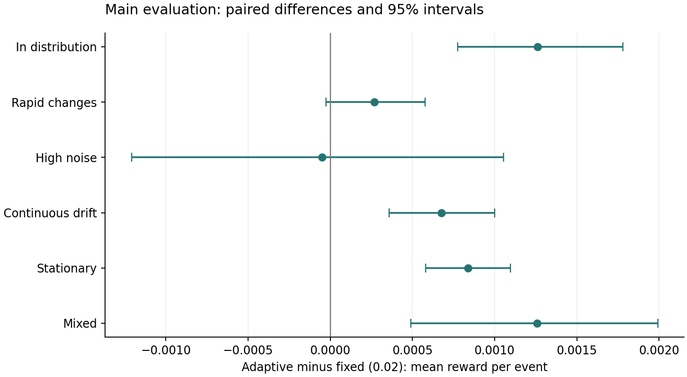
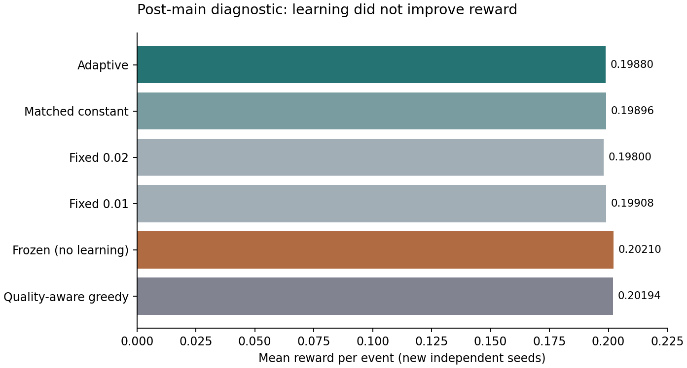
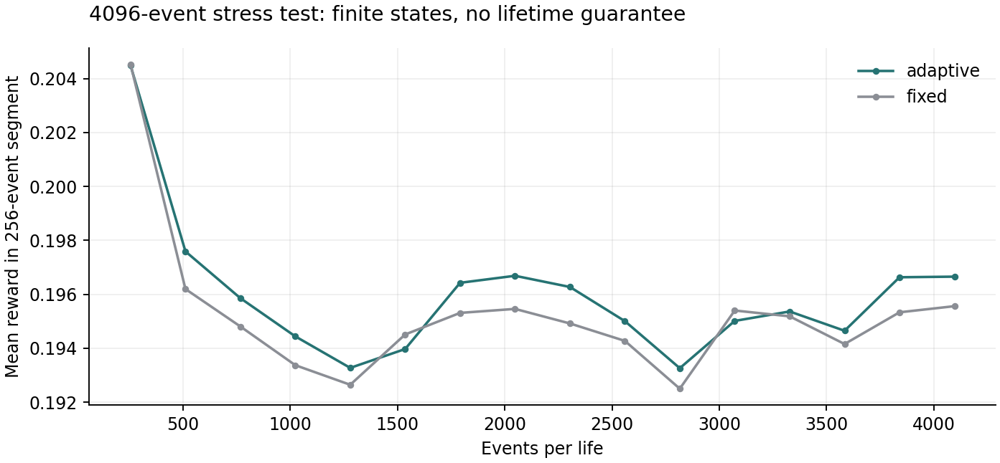

# WUYU 第一轮实验报告

2026-10-10 · 机制实验 · 已完成实际训练与独立评估

## 先看结论

这一轮没有证明历史调节带来额外适应收益。它完成了持续交互、在线更新、训练、独立测试和因果干预的可运行闭环，但结果不支持现在扩大模型。补充检查表明，在当前环境与行动规则下，完全不更新的对照表现更好。

这不是数字生命、欲望、意识或人格已经产生的证据，也不是这些目标不可能实现的证据。应保留实验工具，重新校准环境与对照，再研究更复杂的机制。

## 实际做了什么

6 个资源点组成环。个体移动并采集；收益受隐藏质量、当前存量、噪声和移动成本影响。采集会耗损资源，资源逐步恢复，位置与全部学习状态持续保留。每步是一次移动及采集事件。系统只能在采集后观察该点带噪质量，不能读取隐藏质量或变化时间。

本实现是小型预测与控制系统：6 个在线预测权重，9 参数的学习步长调节器，以及反馈历史统计。动作评分和探索规则由我们指定。调节器通过外层搜索训练，评估时参数固定；预测权重与历史统计继续更新。它不是从零自然演化的生命体，也不是完整仿脑网络。

| 方法 | 在线变化 | 离线选择 |
| --- | --- | --- |
| 窗口记忆 | 写入反馈，窗口平均形成预测 | 窗口长度；选中 32 |
| 固定可塑性 | 误差修正预测权重 | 固定步长；选中 0.02 |
| 历史调节可塑性 | 权重、历史统计及由其决定的步长 | 9 个调节器参数；3 次搜索中选验证最优 |
| 匹配平均步长 | 相同误差修正，步长不随事件变化 | 使用主模型训练平均步长 0.011051 |
| 等价递归状态 | 与历史调节模型相同方程，换成状态解释 | 不训练新模型；检查轨迹等价 |

可塑预测更新为 q ← clip(q + α × (观察反馈 − q), 0, 1)。adaptive 的 α = 0.01 + 0.94 × sigmoid(θ·特征)。历史特征包括快慢误差统计、反馈变化、访问间隔等；这些特征的形式是人工选择，不应称为内生价值。

各方法共享观测、动作评分、探索规则和事件预算，但有效容量不完全相同。memory 存 6×32 个反馈值；adaptive 有额外的调节参数与统计记忆。这不是严格容量匹配的架构竞赛。

## 训练与评估范围

训练 24 条轨迹，每条 384 事件；验证 24 条新轨迹，每条 512 事件。调节器进行 3 次独立搜索，每次 60 代、48 候选。根据验证集选择种子 47，主测试前固定参数。主评估为 6 类×128 条＝768 条独立轨迹，每条 1024 事件；各方法使用相同外生过程。另有每类 32 条、4096 事件的压力测试。

原主实验在 CPU 上实际运行约 44.4 秒。高吞吐来自小规模状态和 NumPy 批量计算；这不代表大模型训练只需同样时间。没有 GPU、PyTorch 或外部语言模型参与训练。训练搜索共评估约 7963 万个模拟候选事件，它们不是 7963 万个不同个体，也不是那么多独立样本。

置信区间为按环境类别分层、轨迹配对的 2000 次 bootstrap；类别等权。它们描述给定模型在这些环境样本上的不确定性，不涵盖所有架构、训练随机性或现实世界情况。分类指标及次指标用于解释，不做事后挑选。

## 主评估结果

| 方法 | 平均净收益/事件 | 所选点预测 MSE | 平均步长 |
| --- | --- | --- | --- |
| 窗口记忆 | 0.191221 | 0.036159 | 0.049146 |
| 固定可塑性 | 0.198539 | 0.039382 | 0.020000 |
| 历史调节可塑性 | 0.199247 | 0.043502 | 0.010663 |
| 匹配平均步长 | 0.199297 | 0.043468 | 0.011051 |

窗口记忆行的步长列记录 1/有效窗口长度，仅供描述平均操作，不是突触更新步长；窗口移除旧反馈时，更新也不等同于简单误差修正。预测 MSE 针对各方法实际访问的点，因此访问分布不同，不能当成相同预测样本上的直接能力排名。

| 比较：adaptive 减去对照 | 平均差及 95% 区间 |
| --- | --- |
| 固定可塑性 | +0.000708 [+0.000469, +0.000947] |
| 窗口记忆 | +0.008026 [+0.007634, +0.008430] |
| 匹配平均步长 | -0.000050 [-0.000296, +0.000192] |

主模型比原定 fixed 网格中选出的模型略好，名义上满足 H1 的统计判定；但它没有优于匹配平均步长的简单对照，H3 未获支持。原网格最低为 0.02，而主模型平均约为 0.011，比较包含搜索范围差异。因此不能把主差值归因于历史调节。

| 训练搜索种子 | 验证收益 | 测试收益 |
| --- | --- | --- |
| 11 | 0.201392 | 0.199334 |
| 23 | 0.201349 | 0.196455 |
| 47 | 0.201778 | 0.199247 |

三次搜索的测试表现有差异；其中一次更弱。主模型按验证集选定，没有因为另一搜索在测试中略好而替换。这些结果不足以宣称该学习方法普遍优越。

## 干预结果：有影响，未证明有益

在第 384 事件复制完整状态，只清空一份的快误差、慢误差和反馈变化统计。保留两份的预测权重、访问计数、年龄与近期反馈。先给予完全相同的强制后续反馈，再另外比较自由行动分支。强制反馈分析不计入主闭环性能。

| 检查 | 实际结果 |
| --- | --- |
| 相同后续反馈下，步长平均绝对差 | 0.00006103 |
| 相同后续反馈下，预测平均绝对差 | 0.00006565 |
| 保留统计 − 清空统计：自由行动收益差 | +0.000113 [-0.000146, +0.000381] |
| 可塑权重与等价状态写法：轨迹最大差 | 0.0 |

H2 的窄义机制检查成立：历史统计对后续更新有非零作用，但效应很小；收益差区间覆盖零，没有证据表明保留这些统计在这里有益。等价状态实现产生相同轨迹是方程等价的检查，不是新发现，也不说明意识或生命性。

## 事后补充检查：环境的学习需求未通过校准

以下不是主协议的预注册结果。发现步长范围问题后，先另写 SUPPLEMENT_01.md，再使用新的独立种子：6 类×64 条＝384 条，每条 1024 事件。不重新训练，不修改主模型，也不覆盖主评估。

| 方法 | 新独立样本平均净收益/事件 |
| --- | --- |
| 历史调节可塑性 | 0.198797 |
| 匹配平均步长 | 0.198959 |
| 固定步长 0.02 | 0.198005 |
| 固定步长 0.01 | 0.199075 |
| 冻结预测（不学习） | 0.202098 |
| 已知当步质量的贪心策略 | 0.201945 |

adaptive − fixed 0.01：-0.000278 [-0.000683, +0.000122]。更公平的较低固定步长对照没有更差。

adaptive − 冻结预测：-0.003300 [-0.003711, -0.002884]。冻结预测在这套配置下更好，因而当前实验不能作为历史学习带来收益的有效展示。

可能的解释是资源恢复与移动代价使稳定、较均匀的采集策略已经很强，而当前预测与行动规则不能有效利用所学信息。这是解释假说，本轮没有单独操纵各因素验证。即使可读取当步真实质量的贪心策略也没有明显优于冻结预测；它不是长期最优策略，不能据此断言信息无用或学习不可能获益。

## 长期运行与计算连续性

4096 事件压力测试：adaptive 平均收益 0.195973，fixed 为 0.195258；最终预测均为有限值并处于 [0,1]。有界性部分来自显式裁剪，不能称为自发自维持，也不能由有限时长推出永久学习。

6 项针对关键风险的自动检查通过：行动改变环境；观测不暴露隐藏质量；相同种子与等价写法一致；完整检查点恢复后轨迹逐项一致；干预只改指定统计；批量与单候选运行一致及数值有界。检查结果记录在 VALIDATION.md。

## 本轮能支持什么

可以支持：该机制实验闭环可运行并可复现；历史统计确实进入学习更新；可以通过检查点和选择性清空实施干预；主分析与事后诊断能够分开保存。

不能支持：历史调节优于匹配的固定步长；系统形成了自主目标或内生价值；出现数字生命、欲望、意识、人格；当前小控制器可以直接扩大成 0.xB 基底；资源预算与神经参数等价于生物代谢。

建议暂不扩大参数。下一轮先校准任务：确认在相同观察/行动接口下，可利用信息的学习或规划基线稳定优于冻结预测，再比较固定可塑性与历史调节。需要增加延迟后果或必须记住的隐变量时，仍须保留简单基线，不能故意设计只有预定模型才会成功的环境。

## 交付与复现

完整包包括 PROTOCOL.md、SUPPLEMENT_01.md、README.md、独立源代码、6 项检查、训练参数与日志、主评估逐轨迹 CSV、干预原始数组、完整检查点、压力测试结果、图表和本报告。运行方式见 README.md。预先记录的协议及代码 SHA-256 位于 results/run_manifest.json；补充检查有单独时间与哈希。

本轮报告只使用本轮真实输出。旧 WUYU_0A 的偏好强化结果未混入。

## 参考来源

- [Backpropamine：神经调制可塑性](https://arxiv.org/abs/2002.10585)

- [Evolving Plasticity：个体内学习规则](https://arxiv.org/abs/1904.01709)

- [Sensorimotor Lenia：自组织个体与扰动检验](https://arxiv.org/abs/2402.10236)

- [Loss of plasticity：持续学习的长期问题](https://www.nature.com/articles/s41586-024-07711-7)

这些来源支持机制选择与研究问题。本代码为独立简化实现，不声称复现上述论文的实验结果。
