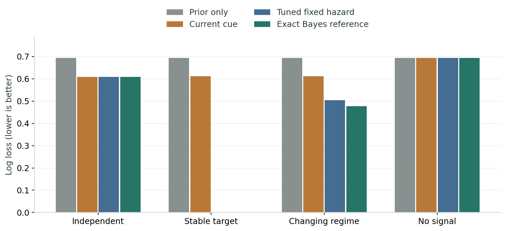
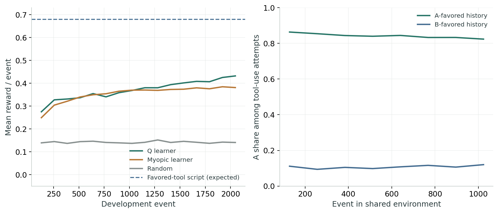
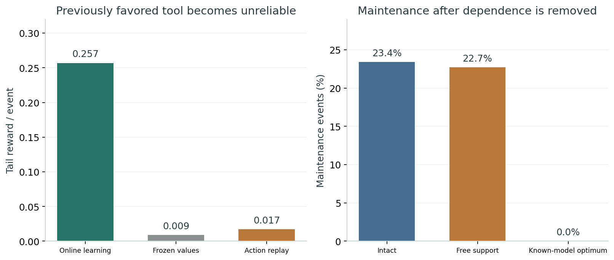

# WUYU_02 实验报告

经历形成差异之后，它能否重新理解依赖？

## 先看结论

四项校准全部通过。普通 Q 学习的工具原型通过了控制学习、历史分化与失效调整三项判据；解除维护依赖后的调整幅度未达标。

本轮把可运行研究推进到持续经历影响行动、行动改变工具状态的闭环。它没有实现开放式能力生成，也没有证明欲望、意识或人格。更关键的发现是：明显的历史差异和失效后的适应，125 个普通行动价值就能产生；这些现象不能单独充当物欲已经具备主体性的证据。

| 实际规模 | 内容 |
| --- | --- |
| 1,024 条校准测试轨迹 | 四类世界各 256 条，每条 512 步；五个预测方法共享线索 |
| 128 对发展个体 | 每对两个历史分支，共 256 个模拟个体；每条发展 2,048 步 |
| 共同环境与七个干预分支 | 共同环境 1,024 步；各干预 2,048 步；分支不是新的独立个体 |
| 125 个 Q 值 | 25 个工具状态 × 5 动作；没有神经语言模型或外部模型 API |

## 一、先确认测量问对了问题

校准阶段只研究信息与预测，动作不改变世界。隐藏答案不反馈给预测器。真实线索正确率为 0.70；无线索条件为 0.50。精确贝叶斯参考预先知道生成转移规律，因此它是检验任务的参考，不是与其他方法公平竞争的新学习架构。

| 世界 | 冻结先验 | 仅当前线索 | 累积不遗忘 | 调好固定变化率 | 精确参考 |
| --- | --- | --- | --- | --- | --- |
| 每步独立 | 0.6931 | 0.6080 | 5.0456 | 0.6080 | 0.6080 |
| 长期稳定 | 0.6931 | 0.6109 | 0.0000 | 0.0000 | 0.0000 |
| 隐藏变化率切换 | 0.6931 | 0.6117 | 6.5478 | 0.5032 | 0.4765 |
| 完全无线索 | 0.6931 | 0.6931 | 0.6931 | 0.6931 | 0.6931 |

表中为第 65—512 步的平均对数损失，越低越好。累积证据模型假设答案永不改变，所以在独立或变化世界中会过度自信；它是明确失配的对照，并不代表所有使用历史的方法。评分裁剪概率以避免无限损失。

在独立世界中，精确参考与只看当前线索的概率轨迹在数值容差内一致；在无线索世界中，所有模型保持均匀预测。这两项是可解析负对照，不是从结果中挑选的失败案例。

稳定世界里，多次证据的累积明显有益。变化世界里，精确参考相对仅当前线索降低损失 0.1353 [0.1252, 0.1452]；相对验证选出的固定变化率降低 0.0268 [0.0236, 0.0300]。方括号为配对 95% bootstrap 区间。后一差值不能解释为新元学习机制获胜，因为参考掌握真实生成规律。

## 二、一个可以学习维护工具的最小闭环

每步有一个二值任务。基础通道正确率 0.60；工具 A/B 能提供另一条真实线索。使用工具消耗一次可用次数；维护消耗当步机会并付出 -0.20，将次数恢复到 4。正确作答 +1，错误 -1。学习器只能观察两个剩余次数和行动后的奖励，不能读取隐藏答案或准确率；线索解码器由我们预设。

两种成长经历分别让 A 或 B 更可靠（0.95 对 0.55）。起点一致的个体经过发展后，进入两个工具同样可靠（各 0.90）的共同环境。主诊断将剩余次数统一为零，以匹配当前状态；另有保留原工具状态的自然延续分支。

动作由普通 Q 学习从反馈中选择。验证集选出步长 0.15；折扣 0.95，探索率 0.08。工具类型、容量、维护方式、奖励与 Q 更新规则都固定。它学到的是行动价值，没有创造新的工具类别，也没有改变自身的学习规则。

| 发展阶段对照 | A 占优历史末段回报 | B 占优历史末段回报 |
| --- | --- | --- |
| 普通 Q 学习 | 0.4129 | 0.4226 |
| 折扣为零的短视学习 | 0.3818 | 0.3783 |
| 随机动作 | 0.1417 | 0.1388 |
| 固定维护并使用 A | 0.6837 | 0.0430 |
| 固定维护并使用 B | 0.0333 | 0.6826 |

知道哪种工具更好的脚本明显优于学习器，说明当前模型远未达到该世界的可达水平。短视学习器也能出现维护和工具偏好；因此看到这些行为，不能直接推断系统进行了明确的未来模拟。事后配对分析中，Q 学习相对短视对照的回报差为 0.0377 [0.0190, 0.0561]。

## 三、历史分化和因果干预得到什么

共同环境最后 256 步中，A 历史个体的工具 A 使用尝试占比为 83.04%，B 历史个体为 11.21%；配对差为 71.83 [66.61, 76.65] 个百分点。这里按每个个体在 A/B 使用尝试中的比例统计，不是所有行动中的 A 比例。

清空全部 Q 值后，这一配对历史差变成零。双方工具状态已匹配、后续随机表相同，所以清空唯一的学习载体后轨迹相同本就是实现应有的性质。这定位了本模型的历史载体，不能据此把 Q 表叫作自我。保留原工具状态的自然延续也得到接近的历史差。

| 预定判据 | 实测效应及 95% 区间 | 判定 |
| --- | --- | --- |
| B1：发展回报超过随机至少 0.10 | 0.2711 [0.2461, 0.2964]；0.2838 [0.2606, 0.3073] | 通过 |
| B2：历史占比差至少 10 个百分点，擦除后消失 | 71.83 [66.61, 76.65] 个百分点；擦除后 0 | 通过 |
| B3：工具失效后在线回报超过冻结至少 0.05 | 0.2478 [0.2331, 0.2624] | 通过 |
| B4：外部支持使维护率降低至少 3 个百分点 | 0.72 [0.20, 1.26] 个百分点 | 未通过 |

B1—B4 是预先固定的描述性关卡，区间按 128 个独立个体对重采样。未做覆盖所有对照的多重比较校正，不将它们合并成关于主体性的总体显著性结论。B4 的小幅下降区间虽高于零，仍然没有达到预先规定的实际幅度。

## 四、没有通过的依赖解除，是本轮最具体的瓶颈

外部支持已允许历史优势工具在可用次数为零时继续提供线索，但学习器仍把 22.70% 的行动用于维护它；未解除依赖时是 23.42%。

主实验后的解析诊断枚举全部 25 个状态与 5 个动作，核对真实世界实现，再求解已知模型的最优策略。外部支持下可以始终直接使用可靠度 0.90 的工具，长期期望回报为 0.90×1+0.10×(-1)=0.80，维护率为零。价值迭代残差小于 1e-10。

因此，世界确实允许省去维护；当前学习器在给定经历和预算下没有充分学会。尚未区分有限训练、状态访问不足、估值误差等原因，不能将残留维护浪漫化为忠诚、情感或自我坚持，也不能据此断言所有普通强化学习都做不到。

## 五、数值修复与证据完整性

最终报告前发现：原标量累积滤波会把极强后验舍入为 1，随后无法恢复。80 次支持证据接 80 次相反证据，理论后验应回到 0.5，原实现仍输出 1.0。修复后同时保存两个概率质量，新增回归检查，并按原种子、参数网格和标准完整重跑。

首轮源代码与全部输出保存在 archive/initial_run/；修复记录在 AMENDMENT_01.md。最终以 results/ 为准。原四项校准判定不变，工具世界逐步数据与首轮完全一致。重跑不增加独立样本量。

最终 7 项必要检查通过。正式重跑耗时 9.81 秒，使用 Python 3.12.14、NumPy 2.3.5 和 CPU 批量计算；速度来自极小状态空间，不代表大模型训练成本。运行前后协议与主代码哈希一致。

## 六、对物欲路线的实际影响

可以保留的进展：已得到校准过的世界、真实行动反馈闭环、历史差异的载体、可复制检查点与可选择干预。相比上一轮，动作选择能够学习，工具条件确实改变可获得的信息。

仍未实现：自发产生工具或身体结构、内生价值来源、学习规则在个体内发生发展、社会关系、语言、开放式能力增长或主观体验。维护预设的外部工具也不是维持整个数字个体的组织。

下一项最有辨别力的工作，是比较显式学习行动后果并做反事实重估的模型，与延长训练、改善访问的普通 Q 学习：它们能否更快识别已经不必要的维护？在相同先验、交互与计算预算下比较，避免把已知世界模型直接赠予新方法。

同时需要提出更强的结构生成假说：允许可组合能力或约束由经历形成，并事先说明什么结果会推翻这个假说。当前不扩大至 0.xB，也不自动进入社会语言阶段；B4 没过，而且普通 Q 学习已经解释了前三项现象。

## 复现与材料

完整包包含原始方案、修复记录、解析诊断方案、全部源码、七项检查、训练与验证选择、逐轨迹和逐步数据、检查点、源文件哈希与本报告。运行方法见 README.md。demo.py 可载入本轮真实检查点，运行单个个体的干预演示，不改写原实验。

## 研究依据

- [贝叶斯学习与部分可观察规划](https://jmlr.csail.mit.edu/beta/papers/v12/ross11a.html)
- [组织与约束闭合](https://montevil.org/publications/articles/2015-mm-organisation-closure-constraints/)
- [信息作用的反事实干预](https://arxiv.org/abs/1806.08053)
- [学习内在奖励与外层目标](https://arxiv.org/abs/1804.06459)
上述资料提供研究问题与方法背景。本代码是独立简化实现，不声称复现论文，实验结论来自交付包中的本轮数据。
