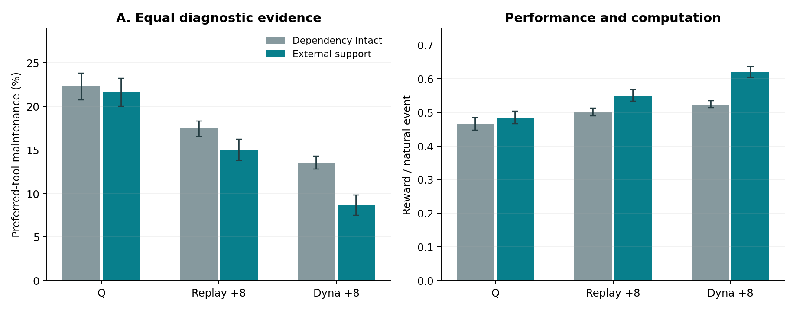
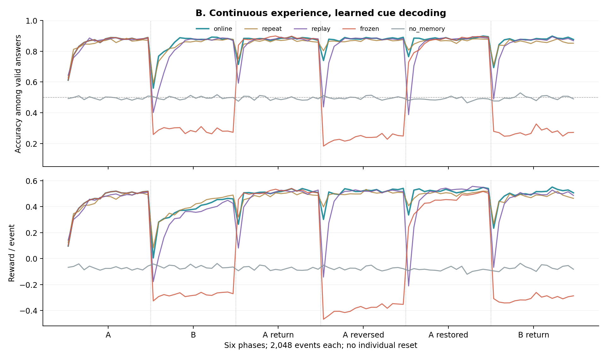
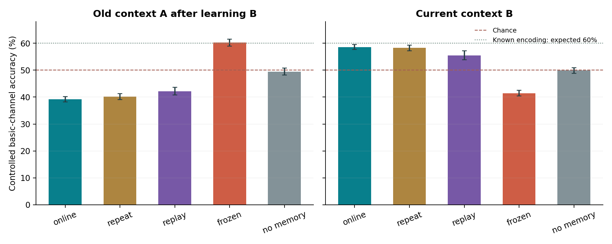
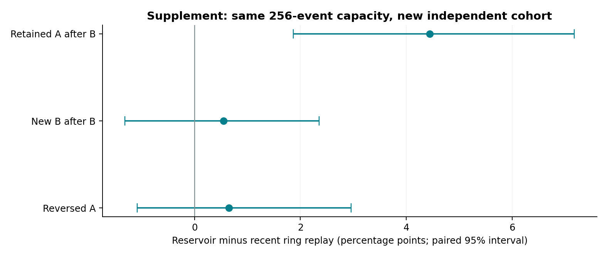

# WUYU_03：感知学习已接通，跨情境保留仍是缺口

## 已实现什么，尚未解决什么

本轮已经实际运行一个小型混合持续学习核心：神经网络自行接收含噪线索、跨空白时刻保留信息、给出答案，并根据事后正确反馈学习；工具选择与维护由学习控制器完成。原来由程序直接把线索当作答案的环节已从新核心移除。

核心能力得到支持，旧技能保留没有达标。它能够学会当前情境，并在规则反转后重新学习；学习另一情境却会明显损害旧情境表现。补充的长历史采样改善有限，不能宣布解决持续学习。

| 组成 | 实际实现 |
| --- | --- |
| 感知网络 | 17 维输入，24 维 tanh 循环隐状态，二元读出；1,033 个可训练参数 |
| 动作控制 | 2 情境 × 25 次数状态 × 5 动作 = 250 个 Q 值；实际反馈更新 + 4 次 Dyna 备份 |
| 后果模型 | 从观察到的状态转移和奖励学习；影响动作估值；不读取真实编码规则 |
| 记忆与连续性 | 循环隐状态、神经参数、Q/模型、最多 256 条经验、上一反馈和内部随机状态均可保存 |
| 训练范围 | 主测试每方法 32 个个体 × 12,288 事件；补充使用新的 32 个种子 |
| 仍由设计者规定 | 状态接口、情境、工具、维护规则、奖励、学习目标、课程；没有自创目标或语言能力 |

## A：为什么旧任务没有解除维护依赖？

64 对旧历史个体，比较自主探索与 8 次统一关键探测。起点来自旧检查点加共同阶段真实 Q 更新；不同于 WUYU_02 原干预的起点。环境中的免费支持只在零次数使用时能直接观察到。旧版宏动作代答仅用于这一诊断。

预定主对比：统一探测给普通 Q 学习带来的额外“维护下降”，为 0.44（95% 区间 -0.38～1.27）个百分点。区间包含零，因此本次不支持“只要补足这些关键证据，普通 Q 就会明显解除依赖”。这也不能排除其他探测剂量、时序或探索策略。

| 方法（统一探测） | 仍需维护 | 免费支持 | 维护下降 | 支持期回报 | 每真实事件备份 |
| --- | --- | --- | --- | --- | --- |
| q | 22.3% | 21.6% | 0.64 个百分点 | 0.484 | 1 |
| replay | 17.5% | 15.0% | 2.42 个百分点 | 0.550 | 1 + 8 |
| dyna | 13.6% | 8.7% | 4.92 个百分点 | 0.620 | 1 + 8 |



回放和 Dyna 的效果提示经验利用与信息传播值得继续研究。Dyna 也改善了仍需维护时的表现，因此不能把它相对 Q 的全部优势都归为识别免费支持。模型以完整共同历史形成统计，回放初始缓存为最近 512 条；模型压缩、采样分布、奖励估计及有效信息保留并非完全相同，不能据此声称模型方法本质优越。

| 方法 | 探测后其他状态选择改变 | 支持期回报 | 撤回后回报 | 撤回后维护率 |
| --- | --- | --- | --- | --- |
| q | 0.0% | 0.484 | 0.466 | 22.0% |
| replay | 0.5% | 0.550 | 0.492 | 15.4% |
| dyna | 1.1% | 0.620 | 0.537 | 11.6% |

其他状态是过去见过、在探测阶段没有直接环境交互的 24 个状态。无反馈选择变化仅说明内部更新传到了其他选择，不保证选择更好，更不是新任务泛化或因果理解的充分证据。后续自然互动包含再学习；撤回后的回报是恢复描述，不是瞬间推理能力。

## B：感知学习核心真的在使用记忆吗？

每个事件依次呈现情境/工具信息、含噪线索、空白延迟、作答。作答时不再呈现线索；无记忆对照在每个微时刻把隐状态清零。有效答案正确 +1、错误 −1；维护与无效使用 −0.20。由于任务只有两个答案，个体能够从自己的答案及正确反馈推回标签。这是事后监督，不是预先泄漏，也不是完全无监督。

验证集仅用于从 .005/.02/.05 选一个全局学习率，选中 0.05；主测试没有再调参。经历顺序为 A → B → A 返回 → A 规则反转 → A 恢复 → B 返回，跨阶段不重置个体。网络梯度只覆盖当前事件的 4 个微时刻，不能声称无限长时序学习。



| 检查 | 结果 | 判定 |
| --- | --- | --- |
| 初始 A 末段有效答案准确率 | 88.15（95% 区间 87.32～88.98）% | 通过 B1 |
| 受控 A：在线 − 无记忆 | 9.99（95% 区间 8.04～12.01）个百分点 | 通过 B2 |
| 规则反转后受控 A：在线 − 冻结 | 19.69（95% 区间 17.70～21.72）个百分点 | 通过 B3 |
| 学 B 后旧 A：近期回放 − 重复当前 | 1.97（95% 区间 0.79～3.39）个百分点 | 未通过 B4：区间下界未超过 3 个百分点 |
| 检查点恢复 | 同一未来输入下行动、概率、隐状态、参数、缓存逐项相同 | 通过 B5 |

自然行动中在线组初始 A 末段准确率约 88.1%，包含其选用高质量工具的影响。受控评估统一使用正确率 .60 的基本通道，已知编码时的期望最佳准确率为 60%。这两种准确率不应直接混用。冻结组未经元学习训练，它的失败不能排除所有固定权重网络的状态适应能力。

## 主要缺口：学习新情境后，旧技能明显受损



在线组受控 A 准确率从 59.6% 降至 39.2%；变化为 -20.39（95% 区间 -21.90～-18.93）个百分点。能够重新学会 A，与同时保留 A、B 两套规则，是不同要求。

近期回放比重复当前经历的旧 A 表现高约 1.97 个百分点，但新 B 低约 2.76 个百分点。原工程判据未通过。两者都做每事件两次梯度计算，但维护等无新标签事件中，回放仍可使用旧标签，重复当前则是零有效梯度；实际非零学习次数不同，不能把小幅差异仅归因于记忆内容。

## 补充：保存更长历史，是否就足够？

主实验后发现：B 阶段结束时，近期环形缓存中 A 经历占比为 0。于是先写 SUPPLEMENT_01.md，再在新的 32 个种子上比较相同 256 条容量的近期回放与 reservoir sampling。后者以流式均匀抽样保留全部历史中的样本，不读取情境来选择样本。补充没有改写主实验 B4。



| 补充比较：长历史 − 近期回放 | 差值 | 预设结果 |
| --- | --- | --- |
| 学 B 后的旧 A | 4.44（95% 区间 1.87～7.18）个百分点 | S1 未达标：区间下界 <3 个百分点 |
| 学 B 后的新 B | 0.55（95% 区间 -1.32～2.36）个百分点 | S2 在预设 −2 个百分点界内 |
| 反转阶段的当前 A | 0.65（95% 区间 -1.09～2.96）个百分点 | S3 在预设 −2 个百分点界内 |

阶段 B 后，长历史缓存中 A 的平均占比为 52.4%，但受控旧 A 的准确率仍只有 46.0%，近期缓存为 41.6%。保存旧样本有帮助的迹象，但未可靠达到预设改善幅度，也没有恢复好旧技能。

这支持进一步区分表示干扰、情境识别、回放时的状态匹配以及记忆调用问题；当前实验尚未把这些原因分开。长历史样本也可能包含过时规则，本轮未见超过预设界限的明确代价，不代表在其他变化频率下没有代价。

## 计算量、样本与可复现性

| 主方法 | 每个体真实事件 | 平均非零神经更新 | 每个体控制备份 | 本环境批次耗时 |
| --- | --- | --- | --- | --- |
| 在线学习 | 12288 | 8913 | 61,440 | 11.3 秒 |
| 重复当前经历 | 12288 | 17968 | 61,440 | 16.1 秒 |
| 近期回放 | 12288 | 21122 | 61,440 | 16.3 秒 |
| 首阶段后冻结 | 12288 | 1481 | 61,440 | 6.5 秒 |
| 移除跨时刻记忆 | 12288 | 7879 | 61,440 | 11.1 秒 |

主运行（含 A、选参、B、评估和数据保存）约 78.5 秒；补充约 34.3 秒。均为当前云端 CPU 环境，Python 3.12.14 / NumPy 2.3.5。耗时不是跨硬件性能基准，也不包含设计、编程、验证与报告制作。独立样本单位为 A 的 64 个历史对、B 的 32 个个体、补充新的 32 个个体；不同方法和阶段是配对分支，不当成更多独立个体。

区间均为固定种子、2,000 次个体/历史对 bootstrap；多项区间是描述性分析，未做整体多重比较校正。主协议与补充假说均有运行前 SHA-256。协议是本地预先固定方案，不是第三方预注册。

主清单中的 source_unchanged 聚合字段为 false：旧环境模块首次导入生成了输入目录下的 Python 编译缓存，扩大了被追踪的文件集合。逐个复核主清单原有的协议、源码与输入，全部 SHA-256 匹配；补充清单记录的文件也全部匹配。保留原字段与审计说明，未改写原始运行记录。

## 哪些事情还不能声称完成

没有训练 0.1B～0.5B 模型，没有实现自然语言、社会互动、开放式结构生成、自主定义学习目标，也没有证明数字生命、意识或内在关切。维护对象依然是预设外部工具，尚未构成维护学习系统自身组织的过程。六阶段实验只能检验有限的适应与遗忘，不能证明长期可塑性问题已经解决。

循环网络与表格控制器通过真实线索和反馈连接，属于混合原型；控制器仍依赖设计好的情境/次数状态表示。存储的旧隐状态可能随网络变化而失配。真实奖励是外部规定的二元正确性目标。以上都是当前边界，不应用“自主成长”措辞覆盖。

## 由结果决定的下一步

优先研究“有历史样本，却不能在正确情境恢复旧能力”的原因。下一轮应固定感知与行动经验，先对比：原循环表示、明确情境条件化的表示、同容量的情境检索/门控；再分别干预旧样本、旧隐状态与上下文线索。必须同时检查旧规则保留、新规则学习与过时规则淘汰，不能只提高一个保留分数。

可组合能力与初级社会互动继续保留在路线中；当前最值得先补的是让多个已学规则在同一个个体内可区分、可调用、可修正。无需因此把“普通学习能否解释”重新设成生命门槛，也无需现在就扩大到零点几 B。

## 如何继续运行交付的训练状态

```bash
python -B -m unittest discover -s tests -v
python -B demo.py --context A --steps 256
python -B demo.py --checkpoint results/supplement/checkpoint_reservoir.npz --context B --steps 256
```

完整包包括源代码、原始逐事件数据、真实训练检查点、协议、补充说明、图表和校验值。演示使用新的随机事件流，默认不覆盖检查点。模拟随程序停止而停止，没有自动部署的长期运行服务。

## 研究依据与借鉴边界

[Gershman, Markman & Otto：经验回放、模型与习惯控制的协作](https://gershmanlab.com/pubs/GershmanMarkmanOtto14.pdf)

[Dohare 等：连续学习中可塑性损失的实验研究](https://www.nature.com/articles/s41586-024-07711-7)

[Montévil 与 Mossio：约束闭合的组织理论](https://montevil.org/publications/articles/2015-mm-organisation-closure-constraints/)

这些来源提供研究动机；本代码是独立简化实现，不宣称论文复现。组织理论尚未在本轮转化为数字生命判据。
