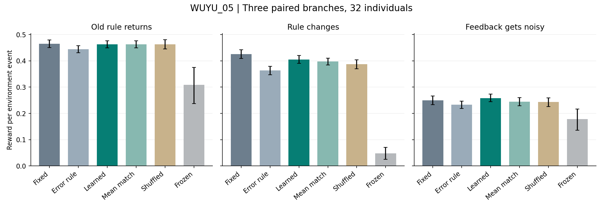
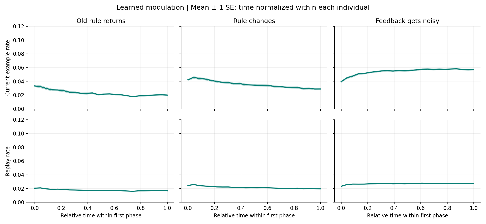

# WUYU_05：经历如何调节持续学习

2026-10-10 · 沿 WUYU_03/04 的实际实现继续推进

## 这次的结论

实现、训练与正式评估已经完成，但未满足全部事前收益门槛；不能宣布学到的经历调节已经优于简单策略。

learned 相对 fixed 的每步环境收益差为 **-0.0047 [-0.0191, 0.0090]**。与误差驱动公式的差为 **0.0289 [0.0148, 0.0440]**。这两项必须一起看。

本轮实际完成了一个共享神经核心、工具动作、重算回放及两个可训练调节量。两个输出分别决定新反馈与旧回放的更新强度。当前没有永久冻结旧规则，也没有为新规则预留额外专家槽位；frozen 只作为干预对照。

## 实际运行了什么

- 神经核心沿用 17 输入、24 隐状态的 1033 参数 RNN；工具控制保留 250 个 Q 值和 Dyna 更新。
- 经验容量 256；每条经验保存最多 8 个前序事件。用当前权重重算回放初态，包含其间没有有效观察的事件。
- learned 为 16 参数双输出调节器，使用当前误差、历史误差统计、预测熵和旧样本误差等 8 个特征。调节器参数经外层训练后固定；神经权重、隐状态、记忆、快慢误差统计在个体运行中继续更新。
- fixed、heuristic、learned 各搜索 48 个候选，训练个体各 8 个；每家族的 3 个候选再在另 8 个体上验证。正式测试 32 个独立种子，各有 3 个配对分支。
- 共同前缀 1536 事件，每个分支 1536 事件。分支统计先按个体合并；没有将 96 条分支当成 96 个独立个体。
- 整个训练、验证、派生对照和正式运行记录用时 390.44 秒。运行时间受机器影响，不代表其他设备速度。

## 三种经历及恢复

共同学过 A/B 后，分别进入旧 A 返回、A 规律反转、A 反馈噪声增加。每支随后经过正常 B，再返回原 A。各个体的变化时刻不同，正式阶段更长。真实原因与噪声率不提供给代理，但 A/B 情境输入仍可见。

| 方法 | 全程奖励/步，95%区间 | 最终旧 B 准确率 | 当前更新率均值 | 回放更新率均值 |
| --- | --- | --- | --- | --- |
| 固定双更新率 | 0.3803 [0.3681, 0.3927] | 82.3% [77.8, 85.6] | 0.0545 | 0.0183 |
| 误差驱动公式 | 0.3467 [0.3352, 0.3576] | 77.9% [73.8, 81.7] | 0.0323 | 0.0243 |
| 可学习双调节 | 0.3756 [0.3640, 0.3879] | 82.6% [79.6, 85.2] | 0.0302 | 0.0203 |
| 匹配平均更新率 | 0.3683 [0.3575, 0.3790] | 79.8% [76.6, 82.7] | 0.0368 | 0.0219 |
| 打乱训练期调节序列 | 0.3645 [0.3506, 0.3780] | 78.4% [74.5, 82.0] | 0.0381 | 0.0219 |
| 分支停止神经学习 | 0.1784 [0.1415, 0.2138] | 86.8% [84.7, 88.6] | 0.0000 | 0.0000 |

旧 B 的读数来自独立克隆上的受控无参数更新测试，不是自主工具表现。更新率均值只统计相应梯度有效的正式分支事件。

## 是否超过简单解释

| 比较对象 | learned − 对照：每步奖励差 |
| --- | --- |
| 固定双更新率 | -0.0047 [-0.0191, 0.0090] |
| 误差驱动公式 | 0.0289 [0.0148, 0.0440] |
| 匹配平均更新率 | 0.0072 [-0.0068, 0.0223] |
| 打乱训练期调节序列 | 0.0111 [-0.0032, 0.0259] |
| 分支停止神经学习 | 0.1972 [0.1620, 0.2358] |

matched_mean 使用 learned 训练轨迹的两种平均率；shuffled 从训练轨迹成对抽取更新量，切断与正式经历的对应。它们不使用正式测试的未来调节序列。各条件都从出生即使用自身策略，因此比较包含发展轨迹差异，不能只归因于挑战阶段的即时调节。

| 分支 | learned − fixed：全程奖励差 |
| --- | --- |
| 旧规律返回 | -0.0018 [-0.0178, 0.0142] |
| 规律反转 | -0.0206 [-0.0389, -0.0022] |
| 噪声增加 | 0.0083 [-0.0121, 0.0277] |

旧 B 保留差为 0.3% [-4.6, 5.5]（区间以百分点计）。这里显示的差值百分数对应准确率差，不是相对百分比变化。

## 适应的时间过程

| 经历 | 方法 | 首段前128步 | 首段末128步 | 恢复段末128步 |
| --- | --- | --- | --- | --- |
| 旧规律返回 | 固定双更新率 | 78.9% [76.0, 81.7] | 86.2% [84.4, 87.9] | 89.0% [87.7, 90.2] |
| 旧规律返回 | 误差驱动公式 | 80.4% [76.9, 83.5] | 86.9% [85.0, 88.6] | 88.7% [87.1, 90.3] |
| 旧规律返回 | 可学习双调节 | 80.1% [77.0, 83.2] | 86.8% [85.0, 88.5] | 90.1% [89.0, 91.3] |
| 规律反转 | 固定双更新率 | 76.6% [73.8, 79.4] | 87.0% [84.7, 88.9] | 86.2% [84.7, 87.7] |
| 规律反转 | 误差驱动公式 | 68.8% [65.6, 72.0] | 84.8% [82.7, 86.8] | 83.4% [81.1, 85.6] |
| 规律反转 | 可学习双调节 | 70.0% [66.2, 73.5] | 86.6% [85.1, 88.1] | 86.9% [85.1, 88.6] |
| 噪声增加 | 固定双更新率 | 52.2% [50.4, 53.9] | 56.3% [54.4, 58.3] | 88.4% [86.9, 89.9] |
| 噪声增加 | 误差驱动公式 | 52.9% [50.6, 55.1] | 55.5% [53.4, 57.4] | 87.6% [85.8, 89.2] |
| 噪声增加 | 可学习双调节 | 56.1% [53.7, 58.4] | 56.8% [55.3, 58.4] | 87.2% [85.0, 89.1] |

表中准确率以取得有效观察的回答为分母。维护和失效动作仍在前面的每步奖励中计入成本，因此不能只看这张准确率表。

更新量随经历变化本身不证明有用；是否有增益以同预算对照和事前门槛为准。

本轮轨迹显示：噪声首段里，learned 的当前更新强度逐渐提高；规律反转首段则在开始后逐渐降低。它尚未形成期望中的可靠分工。正式全程当前更新率均值约为 0.0302，fixed 为 0.0545。这提供了“调节是否过度保守、是否把持续误差当成应该加强学习的信号”的诊断线索，但曲线不足以确定原因。

## 事前门槛

| 门槛 | 结果 |
| --- | --- |
| G1：全程收益优于 fixed | 未通过 |
| G2：三分支无超过 .02 的明确收益损失 | 未通过 |
| G3：旧 B 无超过 3 个百分点的明确损失 | 未通过 |
| G4：优于平均率与打乱序列对照 | 未通过 |

区间为 32 个体级配对 bootstrap，4000 次。多个次级比较没有多重校正。全部门槛、搜索预算和种子在训练前写入 PROTOCOL.md；正式期间的数值源文件哈希未变。

本轮四项门槛均未通过，但含义不同：G1、G4 的差值区间包含零，表示额外收益证据不足；规律反转分支的差值区间整体低于零，对应 G2 中的具体弱项；G3 的旧 B 差值均值接近零但区间较宽，因此不能保证损失小于预定容忍范围，也不能直接断言旧 B 已受到明确损害。噪声分支的均值改善同样包含零，不能宣布它已经学会抑制噪声。

## 资源与工程验证

| 方法 | 调节参数数 | 代理数组 KiB/个体 | 单支含前缀梯度调用 | 正式用时秒 |
| --- | --- | --- | --- | --- |
| 固定双更新率 | 2 | 1270.2 | 6144 | 14.13 |
| 误差驱动公式 | 2 | 1270.2 | 6144 | 14.94 |
| 可学习双调节 | 16 | 1270.4 | 6144 | 15.83 |
| 匹配平均更新率 | 2 | 1270.2 | 6144 | 14.79 |
| 打乱训练期调节序列 | 2 | 1285.5 | 6144 | 14.93 |
| 分支停止神经学习 | 2 | 1270.2 | 6144 | 15.47 |

每条件同样计算当前与回放梯度，零更新量也计算梯度。参数数只指调节器，核心另有 1033 神经参数和 250 个 Q 值。数组内存是批量运行中的均摊数字数组，不是整个进程或全部世界存储；shuffled 还携带训练更新量池。梯度调用列为单支含公共前缀，不是三个分支全部计算总量。

8 项机制测试通过。独立核验从原始动作重算了工具次数、可用观察、噪声线索、反馈与收益；重新计算 learned 的历史统计和更新率；中途恢复后的 256 个事件与正式记录逐项相等，继续至分支结束后的全部网络数组相等。完整状态再保存/恢复后也逐项一致。

## 这一步的意义与限制

这次把双学习调节真正接入了感知—行动—反馈过程，可以据实比较是否有用。所有结果，包括未达标项，都保留在原始数组中。

需要保留的限制：可见 A/B 情境、二元正确性反馈、固定容量与前序长度、手工定义的调节输入和学习目标、8 个训练及 8 个验证个体，以及很窄的异或映射家族。正式种子的随机极性独立，但不意味着出现了训练时没有过的映射类型。因此它尚未验证全新复杂任务中的学习方法迁移。

replay 的前序状态在当前样本更新前重算；随后先做当前更新，再做回放更新。这是一次有限近似，所有条件一致，不能把它描述成对完整历史的精确重新解释。

外层 CEM 学到调节参数，内层继续改神经权重及持续统计；本轮没有证明个体能自行创造学习目标、修改学习算法代码、无限扩展技能或形成欲望与意识。

## 下一步如何由结果决定

若 learned 有稳定额外收益，下一步应从相同前缀检查点切换调节方式，进一步隔离调节本身的因果贡献，再转入未见任务结构。若 learned 未超过简单策略，先分析它在哪种经历中吃亏，检查历史统计、回放相关性与训练范围，不直接扩大参数。

依据本轮结果，下一步优先建议是：从同一已学检查点出发，只替换两个更新量，比较动态调节、固定较快更新及不同回放强度；先区分“更新幅度不足”“旧回放产生干扰”“调节输入不足以区分变化与噪声”三个解释。这是后续诊断建议，本轮没有追加运行或据此改写正式成绩。

复现入口是 run_experiment.py；独立核验入口是 audit_results.py；demo.py 从已保存的实际个体运行 128 个事件。默认都是有限仿真，不是后台常驻服务。

## 机制参考

- [R2D2 作者页：循环回放的状态陈旧与表示漂移](https://willdabney.com/publication/r2d2/)
- [Differentiable plasticity：可塑性本身可训练](https://proceedings.mlr.press/v80/miconi18a.html)
- [Learning to reinforcement learn：循环动态中的学习过程](https://arxiv.org/abs/1611.05763)

这些是机制参考；本实现采用小型 CEM 外层搜索与显式梯度更新，没有复现上述论文。
