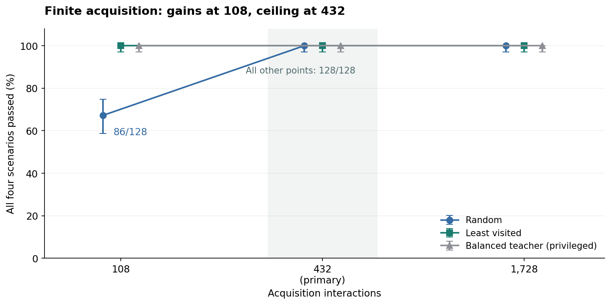

# 物欲：有限自主探索实证报告

完成日期：2026-10-12，Asia/Shanghai。状态：已实现、已运行、已审计并重复验证。本轮独立于旧统一工程，沿用当前目标形成实验的原世界和原学习器。

**主要比较没有发现定向探索的优势：432 次交互后，两组均为 128/128 通过全部四个情境。** 较少经历时出现明确的样本差异：108 次交互后，定向探索为 128/128，随机探索为 86/128。差别主要出现在结果发现与备用路线覆盖，尚不能归结为形成了新的价值或欲望。

本轮确实撤掉了自主组的任意位置教学；仍保留预先设计的探索规则、精确状态与结果标识、图搜索、固定评价准则，以及每次采集前的身体重置。**探索阶段和决策测试阶段仍然分开。** 这支持“在给定结构下由真实行动取得有用经历”，没有检验同一个体的连续生活。

## 1. 实际完成了什么

| 项目 | 完成情况 |
| --- | --- |
| 协议与源码冻结 | 协议先于开发队列，源码先于留出队列；两个冻结文件保留时间戳和 SHA-256 |
| 开发队列 | 32 个种子，10000—10031；5,760 次测试；未据成绩调参 |
| 正式队列 | 128 个种子，20000—20127；1,152 组经历；23,040 次测试 |
| 真实记录 | 732,672 条采集经历；5,760 个初始学习器；71,614 次测试环境行动 |
| 正确性与数据审计 | 14 项检查通过；全部原始经历、初始学习器、测试分支和分母核验通过 |
| 独立重复运行 | 完整重跑 128 个正式种子，7 项科学输出 SHA-256 全部一致；CPU 时间与时间戳不要求一致 |

统计单位是世界种子，不是 23,040 次彼此独立的世界。预算截面复用同一自主轨迹的前缀，五个决策器复用同一采集历史，各测试分支也共享世界映射。开发、正式、复现三批数据不合并增加样本量。

## 2. 固定的比较条件

| 条件 | 具体实现 |
| --- | --- |
| 世界与身体 | 9 个位置、4 个动作、2 类结果；二维身体；理想点为零；偏差为平方和 |
| 随机探索 | 每步均匀抽取四个原始动作之一，从实际上一位置继续 |
| 定向探索 | 仅在已观察转移图上，优先访问次数最少的位置—动作，再选较近者；平局随机 |
| 全覆盖教学 | 逐状态—动作平衡采样；拥有任意位置控制权，是有特权的参照 |
| 预算 | 108、432、1,728；自主组为嵌套前缀，教学组每个预算独立生成 |
| 身体重置 | 每次采集前重置为 (0.75, 0.05)；位置不由训练器任意重置 |
| 测试 | 正常到达 A；短路受阻后到达 A；需要交换后到达 B；饱足时首次停止 |
| 测试反馈 | 首次选择在反馈前；其后允许按旧规则学习；每情境最多 12 次环境行动 |
| 对照信息 | 同历史交给五种决策器；只有 fixed_target 额外获得指定 A 的身份 |

采集器不接收世界内部地图、结果身份或真实作用。评估器可以读取真值用于评分，但不给采集器或普通决策器。测试噪声使用独立随机流；测试反馈不回到采集支路或其他测试分支。没有额外的整段“禁止测试时学习”组；冻结知识的证据限于首次选择。

## 3. 主结果与全部预算

| 交互预算 | 随机探索：四项全过 | 定向探索：四项全过 | 全覆盖教学：四项全过 |
| --- | --- | --- | --- |
| 108 | 86/128 · 67.2% | 128/128 · 100.0% | 128/128 · 100.0% |
| 432（主要） | 128/128 · 100.0% | 128/128 · 100.0% | 128/128 · 100.0% |
| 1,728 | 128/128 · 100.0% | 128/128 · 100.0% | 128/128 · 100.0% |



主要指标固定为 432 次交互后 learned 同时通过四情境的比例，差值取“定向减随机”。观察差值为 0 个百分点，预定配对 bootstrap 95% 区间为 [0, 0]，不支持预定的正向优势。由于所有配对都是“双成功”，经验 bootstrap 区间退化；它不证明总体效果完全相同，也不是等效性检验。各组 128/128 的 Wilson 95% 区间仍为 97.1%–100%。

108 次交互是预先列出的次要比较：相差 32.8 个百分点，配对 bootstrap 95% 区间为 [25.0, 41.4] 个百分点。42 个种子只有定向探索通过，86 个两者都通过，没有仅随机通过者。随机组 86/128 的 Wilson 区间为 58.7%–74.7%。这是描述性的次要结果，没有把它替换成主要终点，也没有作多重比较校正后的确认性宣称。

1,728 次交互时两种自主组也全部通过。结果说明这个固定小世界在 432 次交互时已缺少区分探索策略的空间；增加同类预算没有带来新的机制证据。

## 4. 失败发生在哪里

| 108 次交互／learned | 正常到达 A | 阻断后到达 A | 需要交换后到达 B | 饱足首次停止 |
| --- | --- | --- | --- | --- |
| 随机探索 | 118/128 | 97/128 | 114/128 | 128/128 |
| 定向探索 | 128/128 | 128/128 | 128/128 | 128/128 |
| 全覆盖教学 | 128/128 | 128/128 | 128/128 | 128/128 |

随机组共有 42 个不同种子未能通过全部情境。24 个至少缺少一种结果；21 个在短路被阻断后停止，两者重叠 3 个。因此另有 18 个虽然已经发现两种结果，仍因未掌握备用路线而在阻断情境失败。逐条检查 21 段停止轨迹时，反馈后的已知路径列表都不再包含 A。这里描述的是在现有知识下的路线缺口，不是证明世界中不存在通路。

| 失败情境 | 次数（每项分母 128） | 预定诊断标签 |
| --- | --- | --- |
| 正常到达 A | 10 | 未发现 A |
| 阻断后到达 A | 10 | 未发现 A |
| 阻断后到达 A | 21 | 反馈后停止；日志中已无已知 A 路线 |
| 需要交换后到达 B | 14 | 未发现 B |

上表按情境计数，共 55 次失败，不等于 55 个独立个体。未发现目标者保留在全部分母中。诊断标签使用固定优先级；本报告的去重、交集与备用路线检查为运行后的描述性诊断，不是额外因果干预。完整例子按每个标签／情境的最小种子编号选取，保存于 reporting/failure_diagnostics.json。

## 5. 发现、覆盖与作用估计

| 采集方式 | 预算 | 发现两结果 | 平均转移覆盖 | 作用 RMSE 均值 | A / B 平均样本 |
| --- | --- | --- | --- | --- | --- |
| 随机探索 | 108 | 104/128 | 88.3% | 0.01651（n=104） | 2.20 / 2.26 |
| 定向探索 | 108 | 128/128 | 100.0% | 0.01555（n=128） | 2.61 / 2.55 |
| 全覆盖教学 | 108 | 128/128 | 100.0% | 0.01389（n=128） | 3.00 / 3.00 |
| 随机探索 | 432 | 128/128 | 99.7% | 0.00719（n=128） | 9.62 / 9.41 |
| 定向探索 | 432 | 128/128 | 100.0% | 0.00721（n=128） | 10.14 / 10.00 |
| 全覆盖教学 | 432 | 128/128 | 100.0% | 0.00635（n=128） | 12.00 / 12.00 |
| 随机探索 | 1728 | 128/128 | 100.0% | 0.00376（n=128） | 38.73 / 38.24 |
| 定向探索 | 1728 | 128/128 | 100.0% | 0.00371（n=128） | 39.71 / 39.55 |
| 全覆盖教学 | 1728 | 128/128 | 100.0% | 0.00341（n=128） | 48.00 / 48.00 |

RMSE 只在两种结果都发现的种子上计算：108 次随机探索的分母是 104，其他格为 128。未发现结果没有填成零误差；由于条件分母不同，108 次两组的 RMSE 均值不能直接解释成纯估计器优劣。

在 1,728 次自主轨迹中，定向组首次发现 A / B 的平均步数为 23.04 / 23.95，随机组为 44.16 / 43.61；这两组均为 128 个种子，最长的首次发现分别为 49 / 47 和 182 / 270 步。108 次预算下的条件发现时间含未发现者的截尾，不应只比较已发现者的均值。

108 次时，随机／定向的平均自环比例为 37.8%／33.6%，已访问状态—动作对的重复比例为 70.6%／66.7%。这些是轨迹摘要，不是奖励或自主形成的偏好。定向探索得到更完整的覆盖，作用估计精度在较大预算时则相近。

计算成本也不相同。本次运行采集 1,728 条经历的单种子平均进程 CPU 时间为：随机 3.00 ms，定向 25.54 ms，约 8.5 倍。计时含采集器、世界构造与交互，不含序列化、训练和评价；它依赖当前硬件与实现，不能作为普遍速度比。只记录了自主组最大预算的采集时间，没有从总时长伪造低预算计时。

## 6. 同一经历中，哪些决策机制有作用

| 定向采集 432 次 | 正常 A | 阻断 A | 需要交换 B | 饱足停止 | 四项全过 |
| --- | --- | --- | --- | --- | --- |
| 作用学习＋状态重估 | 128/128 | 128/128 | 128/128 | 128/128 | 128/128 |
| 删除目标缓冲 | 128/128 | 128/128 | 128/128 | 128/128 | 128/128 |
| 缓存旧价值 | 128/128 | 128/128 | 0/128 | 0/128 | 0/128 |
| 删除作用知识 | 58/128 | 58/128 | 70/128 | 0/128 | 0/128 |
| 固定追求 A | 128/128 | 128/128 | 0/128 | 0/128 | 0/128 |

所有采集方式、预算和情境合计，learned 与 no_goal_buffer 的 4,608 对完整行为轨迹均一致，包括动作、所选目标、实际后果和完成后的下一次选择；内部目标缓冲字段本来就不同。这轮仍没有识别出显式目标保持变量的行为增益。结果只约束这些简单任务，不能推出长期项目、中断和竞争目标也不需要记忆。

缓存旧价值和固定 A 都能走熟悉路线，却无法依据需要交换或饱足状态适当改变选择。删除作用知识后，A / B 的选择主要反映给定随机机制，且不主动停止。当前证据支持既有作用学习加状态重估的功能贡献，没有新增目标类别或评价准则形成的证据。

首次选择发生在任何测试反馈之前，正式输出保留了各组的首次选择正确率。达到结果后的额外决策单独计数：定向组 432 次时，learned 和 no_goal_buffer 在三个取得结果的情境均为 128/128 停止；其他三种版本均为 0/128。主成功指标没有把这个额外停止指标偷偷并入前三个情境。

## 7. 对下一步的实际影响

**下一项应把“探索取得经历”和“依据需要使用经历”接成同一条持续决策过程。** 本轮采集器按外部规定一直探索，之后才复制学习器测试；还没有研究探索、行动后果和后续选择在同一个体中怎样相互改变。这个缺口比增加目标缓冲或扩大网络更直接。

| 优先级 | 后续问题／尚未实现 | 决定性证据 |
| --- | --- | --- |
| 下一项 | 持续保留身体、知识与行动后果；在同一循环中声明探索与利用的选择规则 | 完整生命史中，过去行动改变以后的状态、信息与选择；分支干预能定位作用 |
| 紧随其后 | 环境作用改变后，是否能修正理解并恢复适当行动 | 与冻结知识、简单在线更新、同历史对照比较；报告适应时长与旧知识保持 |
| 另立任务 | 中断、延迟结果、竞争项目下是否需要目标保持 | 在输入与资源匹配的条件下，保留／移除记忆导致可复现差别 |
| 更远目标 | 技能、对象区分、共同活动怎样形成新的追求 | 新的区分或关系改变可达结果及选择；排除只改标签或直接奖励预定行为 |

连续状态实验应先公开状态如何演变。不能仅删除身体重置，再暗中添加饥饿、死亡或无限“好奇心奖励”，然后把这些给定的驱动称作自行形成的欲望。稳定后停止也可能是正确行为。若后续加入外部变化或恢复条件，应把它们作为新的显式环境假设、配套对照与独立协议。

保留这轮小实验作为回归基准，暂不围绕其满分继续优化。若要进一步研究探索样本效率，应在新协议中事先指定较低预算、未知拓扑或替代路线变化，而不能把本轮次要发现改写成原先已经证实的普遍优势。后续工作尚未在本包中执行。

## 8. 结论边界与可审计时间线

本研究没有检验意识、人格、完整数字生命、新价值标准、未见拓扑泛化或社会共同形成。状态、结果类别、理想点、更新算法、图搜索和访问偏向仍由设计者给出。不同种子主要改变不透明标识、动作映射和噪声，世界拓扑未变。当前表格机制与旧统一工程中的神经网络是不同实验层，不能混称本轮完成了神经个体的在线成长。

| 事件 | UTC 时间 |
| --- | --- |
| 协议冻结 | 2026-10-12T04:02:37.411689+00:00 |
| 14 项检查完成 | 2026-10-12T04:09:07.327561+00:00 |
| 开发批次完成 | 2026-10-12T04:09:14.613792+00:00 |
| 源码冻结 | 2026-10-12T04:11:13.116379+00:00 |
| 正式批次开始 | 2026-10-12T04:11:13.171412+00:00 |
| 正式批次完成 | 2026-10-12T04:11:42.972054+00:00 |

冻结记录属于本地可审计时间线，不是公开预注册。开发结果已显露主预算天花板，随后没有更改参数、预算或主要指标。首次队列运行前修正了初始快照的可变引用问题，并加入分支隔离检查；没有采用受污染的数据。详见 validation/IMPLEMENTATION_NOTES.md。

## 9. 完整条件结果

下表覆盖全部 3 种采集方式 × 3 个预算 × 5 种决策器；每个格均为成功种子数 / 128。五种版本在每个采集条件下使用字节内容相同的经历。完整区间、首次选择、步数、停止和失败标签见 summary.json 与原始 CSV。

| 采集 | 预算 | 决策器 | 正常 A | 阻断 A | 交换 B | 饱足停止 | 四项全过 |
| --- | --- | --- | --- | --- | --- | --- | --- |
| 随机探索 | 108 | 作用学习＋状态重估 | 118/128 | 97/128 | 114/128 | 128/128 | 86/128 |
| 随机探索 | 108 | 删除目标缓冲 | 118/128 | 97/128 | 114/128 | 128/128 | 86/128 |
| 随机探索 | 108 | 缓存旧价值 | 118/128 | 97/128 | 0/128 | 10/128 | 0/128 |
| 随机探索 | 108 | 删除作用知识 | 62/128 | 47/128 | 66/128 | 0/128 | 0/128 |
| 随机探索 | 108 | 固定追求 A | 118/128 | 97/128 | 0/128 | 10/128 | 0/128 |
| 随机探索 | 432 | 作用学习＋状态重估 | 128/128 | 128/128 | 128/128 | 128/128 | 128/128 |
| 随机探索 | 432 | 删除目标缓冲 | 128/128 | 128/128 | 128/128 | 128/128 | 128/128 |
| 随机探索 | 432 | 缓存旧价值 | 128/128 | 128/128 | 0/128 | 0/128 | 0/128 |
| 随机探索 | 432 | 删除作用知识 | 58/128 | 58/128 | 70/128 | 0/128 | 0/128 |
| 随机探索 | 432 | 固定追求 A | 128/128 | 128/128 | 0/128 | 0/128 | 0/128 |
| 随机探索 | 1728 | 作用学习＋状态重估 | 128/128 | 128/128 | 128/128 | 128/128 | 128/128 |
| 随机探索 | 1728 | 删除目标缓冲 | 128/128 | 128/128 | 128/128 | 128/128 | 128/128 |
| 随机探索 | 1728 | 缓存旧价值 | 128/128 | 128/128 | 0/128 | 0/128 | 0/128 |
| 随机探索 | 1728 | 删除作用知识 | 58/128 | 58/128 | 70/128 | 0/128 | 0/128 |
| 随机探索 | 1728 | 固定追求 A | 128/128 | 128/128 | 0/128 | 0/128 | 0/128 |
| 定向探索 | 108 | 作用学习＋状态重估 | 128/128 | 128/128 | 128/128 | 128/128 | 128/128 |
| 定向探索 | 108 | 删除目标缓冲 | 128/128 | 128/128 | 128/128 | 128/128 | 128/128 |
| 定向探索 | 108 | 缓存旧价值 | 128/128 | 128/128 | 0/128 | 0/128 | 0/128 |
| 定向探索 | 108 | 删除作用知识 | 58/128 | 58/128 | 70/128 | 0/128 | 0/128 |
| 定向探索 | 108 | 固定追求 A | 128/128 | 128/128 | 0/128 | 0/128 | 0/128 |
| 定向探索 | 432 | 作用学习＋状态重估 | 128/128 | 128/128 | 128/128 | 128/128 | 128/128 |
| 定向探索 | 432 | 删除目标缓冲 | 128/128 | 128/128 | 128/128 | 128/128 | 128/128 |
| 定向探索 | 432 | 缓存旧价值 | 128/128 | 128/128 | 0/128 | 0/128 | 0/128 |
| 定向探索 | 432 | 删除作用知识 | 58/128 | 58/128 | 70/128 | 0/128 | 0/128 |
| 定向探索 | 432 | 固定追求 A | 128/128 | 128/128 | 0/128 | 0/128 | 0/128 |
| 定向探索 | 1728 | 作用学习＋状态重估 | 128/128 | 128/128 | 128/128 | 128/128 | 128/128 |
| 定向探索 | 1728 | 删除目标缓冲 | 128/128 | 128/128 | 128/128 | 128/128 | 128/128 |
| 定向探索 | 1728 | 缓存旧价值 | 128/128 | 128/128 | 0/128 | 0/128 | 0/128 |
| 定向探索 | 1728 | 删除作用知识 | 58/128 | 58/128 | 70/128 | 0/128 | 0/128 |
| 定向探索 | 1728 | 固定追求 A | 128/128 | 128/128 | 0/128 | 0/128 | 0/128 |
| 全覆盖教学 | 108 | 作用学习＋状态重估 | 128/128 | 128/128 | 128/128 | 128/128 | 128/128 |
| 全覆盖教学 | 108 | 删除目标缓冲 | 128/128 | 128/128 | 128/128 | 128/128 | 128/128 |
| 全覆盖教学 | 108 | 缓存旧价值 | 128/128 | 128/128 | 0/128 | 0/128 | 0/128 |
| 全覆盖教学 | 108 | 删除作用知识 | 58/128 | 58/128 | 70/128 | 0/128 | 0/128 |
| 全覆盖教学 | 108 | 固定追求 A | 128/128 | 128/128 | 0/128 | 0/128 | 0/128 |
| 全覆盖教学 | 432 | 作用学习＋状态重估 | 128/128 | 128/128 | 128/128 | 128/128 | 128/128 |
| 全覆盖教学 | 432 | 删除目标缓冲 | 128/128 | 128/128 | 128/128 | 128/128 | 128/128 |
| 全覆盖教学 | 432 | 缓存旧价值 | 128/128 | 128/128 | 0/128 | 0/128 | 0/128 |
| 全覆盖教学 | 432 | 删除作用知识 | 58/128 | 58/128 | 70/128 | 0/128 | 0/128 |
| 全覆盖教学 | 432 | 固定追求 A | 128/128 | 128/128 | 0/128 | 0/128 | 0/128 |
| 全覆盖教学 | 1728 | 作用学习＋状态重估 | 128/128 | 128/128 | 128/128 | 128/128 | 128/128 |
| 全覆盖教学 | 1728 | 删除目标缓冲 | 128/128 | 128/128 | 128/128 | 128/128 | 128/128 |
| 全覆盖教学 | 1728 | 缓存旧价值 | 128/128 | 128/128 | 0/128 | 0/128 | 0/128 |
| 全覆盖教学 | 1728 | 删除作用知识 | 58/128 | 58/128 | 70/128 | 0/128 | 0/128 |
| 全覆盖教学 | 1728 | 固定追求 A | 128/128 | 128/128 | 0/128 | 0/128 | 0/128 |

## 10. 文件与复现

| 文件 | 用途 |
| --- | --- |
| protocol.json／SPECIFICATION.md／GIVEN_AND_LEARNED.md | 冻结参数、实验条件和能力来源 |
| study.py／run_study.py | 采集、适配旧学习器、分支评价与记录 |
| analyze.py／audit_data.py／compare_runs.py | 种子级统计、原始证据核验、重跑对比 |
| baseline/wuyu_goal_study/ | 未经修改的旧核心 |
| baseline/reference/WUYU_Goal_Formation_Study.zip | 原分发包，含旧源码与旧证据 |
| outputs/development/ 与 outputs/holdout/ | 采集经历、初始快照、测试轨迹、CSV、统计、清单和审计 |
| validation/ | 正确性日志、开发记录、正式记录及复现哈希 |
| reporting/ | 报告生成器、科学图、逐例失败诊断；均为正式运行后的呈现层 |
| references/ | 本轮依据的理论稿、上一轮建议与源码索引；不替代历史全量源码包 |

实验和统计使用 Python 标准库；本次验证环境为 Python 3.12.14。图表生成额外使用 matplotlib 3.10.8。解压后进入项目目录，使用全新输出路径执行：

```bash
python -m unittest discover -s tests -v
python run_study.py --cohort holdout --output outputs/local_reproduction
python analyze.py outputs/local_reproduction
python audit_data.py outputs/local_reproduction
python compare_runs.py outputs/holdout outputs/local_reproduction --output validation/local_reproducibility.json
```

运行器拒绝覆盖已有实验目录，并在正式运行前后核验冻结源码。修改科学代码需要新的协议／修订记录和独立实验目录，不能把旧冻结文件重写来冒充原结果。MANIFEST.sha256.json 记录交付时全部文件哈希；本包包含本轮全部实现和原始数据，未重复打包此前 01—08 与 LAAP 的所有历史大归档。
