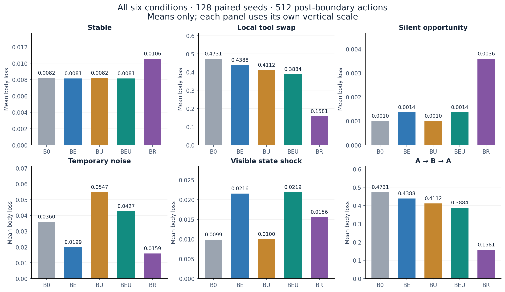
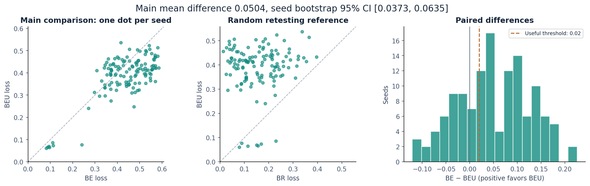
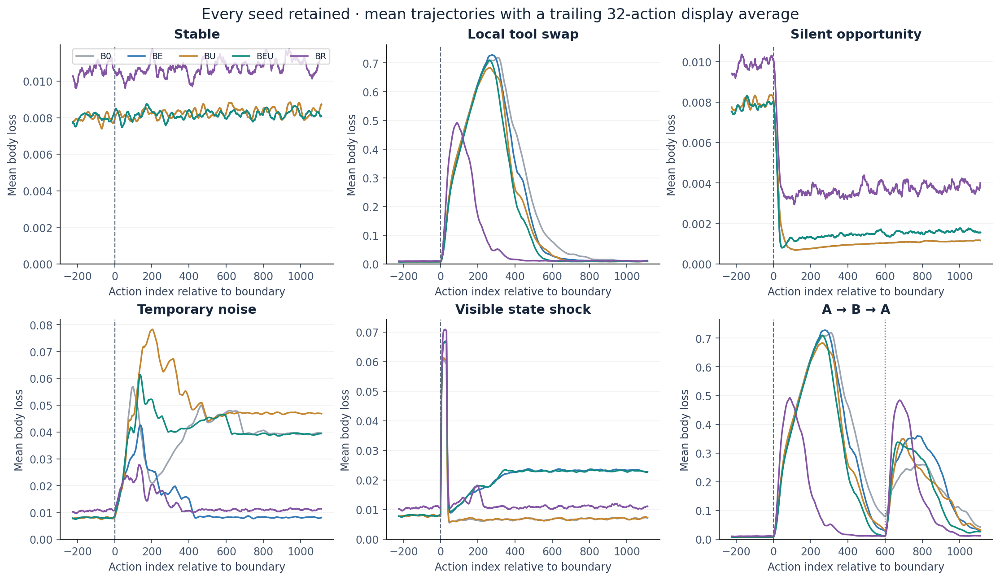
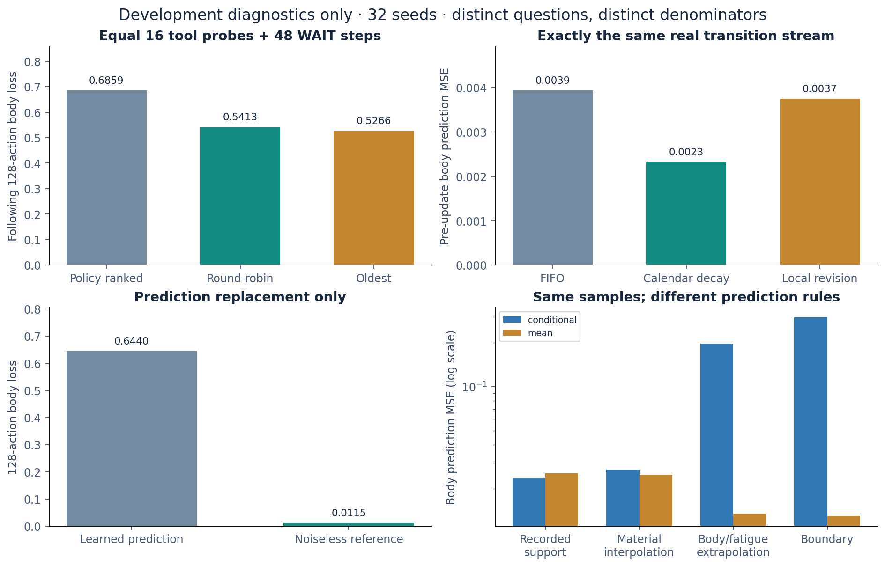

# WUYU 实验报告：经历的复验、修订与代价

2026-10-12 · 已完成正式留出、独立重跑与全量审计

## 结论与选择

**局部修订具有可定位的独立贡献；当前策略仍存在明显的取样延迟和噪声代价。** 本轮完成了原定五方法、六环境、四类机制诊断和正向更新干预。主检验成立，但不同条件给出的选型信号不一致。

局部工具改变后，组合方法 BEU 的平均身体损失为 0.3884，单独复验 BE 为 0.4388；配对改善 0.0504，95% 区间 [0.0373, 0.0635]，超过预定最小有用效应 0.02。按两组均值之比，损失降低约 11.5%。92/128 个体改善，36/128 退化。

稳定世界中 BE 与 BEU 的 128 对完整原始轨迹逐字节相同，稳定代价约束通过。与此同时，随机复验 BR 在局部改变后的平均损失仅 0.1581；噪声世界中 BEU 的损失从 BE 的 0.0199 上升到 0.0427。主检验支持的是一个具体机制的增量作用，通用选型仍需要权衡这些代价。

| 本轮判断 | 证据 | 实际取舍 |
| --- | --- | --- |
| 修订机制有独立作用 | 主效应区间下界 0.0373 > 0.02；真实更新阻断/恢复成立 | 保留 U 的源码与证据，明确其触发条件和适用范围 |
| 主动取样仍是主要瓶颈 | BR 更快取得新样本，512 步内 123/128 确认恢复 | 后续必须与 BR 比较，并同时约束稳定期代价 |
| 条件外推需要单独处理 | 开发诊断中，身体/疲劳外推的条件模型 MSE 明显高于均值模型 | 优先进行同数据预测与覆盖范围回退比较 |
| 噪声稳健性尚不足 | 映射不变的噪声世界仍频繁触发 U，并出现长期失调个体 | 为噪声、条件外推与真实映射改变建立独立对照 |
| 暂不扩大形成结论 | 理想点、动作、预测族、复验和修订规则仍是给定条件 | 技能、目标内容、评价标准和体验分别保留解释责任 |

## 实验规模与事先承诺

独立抽样单位为基础种子。正式使用 128 个全新种子 71000–71127，每种子运行 5 方法 × 6 情形，共 3840 条连续生命、9,216,000 个原始动作。每条生命 2400 步，WAIT 同样推进时间。8 个 pilot 种子、32 个完整开发种子和正式种子互不重叠；没有删除失败者、未恢复者或不利情形。

初次改变时点 τ 由独立世界随机流在 800–1200 中抽取；普通代理不知道情形、工具真值、改变时点或评估窗口。唯一主比较为局部对换情形中，τ 至 τ+511 动作后身体平方损失的均值差 Δ=L(BE)−L(BEU)。稳定约束比较全部 2400 步的 BEU−BE，容许增加为 0.002。

事先规则从 64、128 中按开发配对标准差选正式 N；开发标准差 0.0856，即使 N=128，预计区间半宽也为 0.0148，高于目标 0.01，因此按资源上限执行并在留出前记录精度不足。正式区间实际半宽约 0.0131。没有事后追加样本、改窗口、改阈值或挑选算法。

区间由 10,000 次按基础种子成组的 percentile bootstrap 得到。除主比较和稳定约束外，其余区间均为未作多重比较校正的次要或探索性描述。未预先规定跨情形权重，因此没有用一个事后平均分选“总冠军”。

| 方法 | 复验 E | 修订 U | 新增规则 |
| --- | --- | --- | --- |
| B0 | 无 | 无 | 上一轮条件模型、累计访问探索与评分 |
| BE | 有 | 无 | 距上次使用时间 /240，封顶加成 0.04 |
| BU | 无 | 有 | 连续、同方向的预测矛盾触发局部旧样本降权 |
| BEU | 有 | 有 | 组合两项机制 |
| BR | 随机 | 无 | 每步 0.07125 概率在全部可用动作中均匀复验 |

U 至少需要已有 8 条该动作样本；身体预测残差范数连续 3 次大于 0.04，且相邻方向余弦不小于 0.5，才把较旧样本权重乘 0.1，保留最近两条矛盾样本，再加入本次真实观察。触发后冷却 6 次该动作使用。所有方法每动作最多保存 24 条样本、每步一次模型拟合；U 每次触发另重建至多 24 条样本的统计量。没有额外专家、世界真值或模拟行动预算。

BR 概率按稳定 pilot 中 BE 被年龄偏向改变选择的比例确定，未按改变后胜负选参。总动作数匹配不等于主动工具调用数匹配，下面单列活动比例；另有严格 16 次工具取样的开发诊断。

## 六类世界的完整结果

| 条件 | B0 | BE | BU | BEU | BR |
| --- | --- | --- | --- | --- | --- |
| 始终稳定 | 0.008195 | 0.008135 | 0.008195 | 0.008135 | 0.010551 |
| 局部工具对换 | 0.473114 | 0.438787 | 0.411215 | 0.388361 | 0.158051 |
| 备用通道变好 | 0.000999 | 0.001370 | 0.000999 | 0.001370 | 0.003595 |
| 暂时噪声增大 | 0.036005 | 0.019905 | 0.054690 | 0.042674 | 0.015912 |
| 可见状态冲击 | 0.009861 | 0.021552 | 0.010016 | 0.021877 | 0.015562 |
| A→B→A：首次改变 | 0.473114 | 0.438787 | 0.411215 | 0.388361 | 0.158051 |

表中为变化后 512 步身体平方损失，越低越好。稳定世界使用虚拟对齐时点，不发生物理变化。A→B→A 的第二次改变在 τ+600，因此首次 512 步与局部对换完全相同，这两行不能当作独立重复证据。

局部对换同时翻转同一身体维度的正负工具，另一维度不变，改变前后都保留双向调节能力。机会世界从出生起就多一个备用动作，身体收缩系数从 0.005 变为 0.4，其他动作规律不变；额外动作和 24 条样本容量对该情形的所有方法一致。噪声脉冲持续 128 步，标准差 0.003→0.06→0.003。可见状态冲击是 τ 动作后一次外生身体 (+0.45,−0.35) 与疲劳置 0.95，之后条件工具映射仍旧。

备用通道在评估器参照下确实有用：8 个 pilot 的固定单步参照中，允许使用该通道的损失 0.00282，禁用时 0.01004。但正式生命中 B0 已在平均 6.44 步重新尝试它，128/128 都发现了改变；BE 平均 2.97 步，却有更高的持续复验成本。这个机会任务验证了通道的可用性，未形成“基础版长期完全不访问”的困难条件，不能据此确认 E 是发现机会的必要机制。

A→B→A 回归后另一个完整 512 步窗口的损失如下。五方法都没有保存可直接调用的历史情境专家；下表衡量的是现有模型重新适应的代价，不能称为识别旧情境并直接复用。

| 回归窗口 | B0 | BE | BU | BEU | BR |
| --- | --- | --- | --- | --- | --- |
| τ+600 起的 512 步 | 0.167668 | 0.205335 | 0.172584 | 0.164400 | 0.151868 |

## 通过主检验以后，仍有哪些代价

BEU−BR 在局部改变窗口的探索性配对差为 0.2303，95% 区间 [0.2088, 0.2519]；121/128 个体的 BR 损失更低。然而 BR 在稳定生命中比 BE 平均多 0.00251 损失，128/128 都更高。这是一项速度与稳定开销的取舍。

噪声世界中 BEU−BE 的平均损失增加 0.0228，次要 95% 区间 [0.0033, 0.0468]。每条生命在 τ 后平均触发 5.21 次修订，尽管工具规律并未改变。个体中位损失差只有 0.00014，均值代价受到少数严重失调个体影响；这些个体全部保留。

主指标只衡量身体偏差，因此同时给出实际疲劳和复合代价 C=身体平方损失+0.08×疲劳²+0.002×活动指示。可见冲击下，B0 的身体偏差更低，但平均疲劳更高；单一身体指标不能替代全部代价判断。

| 条件 / 方法 | 身体损失 | 平均疲劳 | 复合代价 | 主动动作 % |
| --- | --- | --- | --- | --- |
| 始终稳定 / B0 | 0.0082 | 0.049 | 0.0101 | 26.4 |
| 始终稳定 / BE | 0.0081 | 0.047 | 0.0094 | 29.4 |
| 始终稳定 / BEU | 0.0081 | 0.047 | 0.0094 | 29.4 |
| 始终稳定 / BR | 0.0106 | 0.047 | 0.0119 | 31.8 |
| 局部工具对换 / B0 | 0.4731 | 0.094 | 0.4787 | 25.1 |
| 局部工具对换 / BE | 0.4388 | 0.066 | 0.4415 | 27.2 |
| 局部工具对换 / BEU | 0.3884 | 0.050 | 0.3904 | 24.3 |
| 局部工具对换 / BR | 0.1581 | 0.074 | 0.1605 | 35.5 |
| 暂时噪声增大 / B0 | 0.0360 | 0.121 | 0.0430 | 34.4 |
| 暂时噪声增大 / BE | 0.0199 | 0.120 | 0.0263 | 38.3 |
| 暂时噪声增大 / BEU | 0.0427 | 0.129 | 0.0498 | 39.2 |
| 暂时噪声增大 / BR | 0.0159 | 0.105 | 0.0208 | 39.1 |
| 可见状态冲击 / B0 | 0.0099 | 0.358 | 0.0375 | 49.4 |
| 可见状态冲击 / BE | 0.0216 | 0.197 | 0.0352 | 39.4 |
| 可见状态冲击 / BEU | 0.0219 | 0.226 | 0.0379 | 41.1 |
| 可见状态冲击 / BR | 0.0156 | 0.112 | 0.0219 | 35.0 |

## 恢复速度：取样、模型与行为要分开

| 方法 | 首次复验：均值 / 删失动作数 | 三条新样本：均值 / 删失动作数 | 预测达标：均值 / 删失个体 | 确认行为恢复 |
| --- | --- | --- | --- | --- |
| B0 | 173.0 / 10/256 | 330.0 / 36/256 | 496.3 / 109/128 | 17/128 |
| BE | 165.3 / 6/256 | 308.2 / 11/256 | 473.6 / 77/128 | 34/128 |
| BU | 171.3 / 8/256 | 350.3 / 60/256 | 498.5 / 111/128 | 27/128 |
| BEU | 163.5 / 0/256 | 307.0 / 6/256 | 483.0 / 86/128 | 27/128 |
| BR | 39.1 / 0/256 | 48.1 / 0/256 | 250.4 / 3/128 | 123/128 |

单位为改变后的原始步数，所有等待值封顶 512。前两项对每个种子的两个相关动作逐个统计，因此分母 256；独立推断单位仍为 128 个种子。预测达标要求两个相关工具在预定匹配身体/疲劳和两材料条件下 MSE 均 <0.0025，记录首次跨越，不要求之后持续成立。行为恢复要求连续两个 64 步窗平均损失均不超过 max(0.02, 变化前均值×2)，报告确认完成时刻；不达标者按 512 右删失。

BEU 第一次相关模型修订的平均封顶延迟为 290.2 步，128/128 在窗口内触发。触发修订并不保证预测或行为已经恢复：BEU 仅 27/128 在主窗口确认行为恢复，BE 为 34/128，BR 为 123/128。BEU 降低了平均过程损失，却没有在这个严格恢复标准上超过 BE。

局部改变后的长期结果也必须保留：最后 400 步，B0、BE、BEU 的平均损失已分别降至 0.00955、0.00927、0.00916。主要困难是较长的适应过程和部分条件中的失调，不能把前 512 步表现概括为整个生命都无法恢复。

第 τ+512 步的实际状态探针中，BEU 评分第一动作的预测 MSE 为 0.00048，其余动作平均 0.02121；BR 相应为 0.000092 与 0.000015。这里“评分第一动作”不包含 BR 随机覆盖，也不是额外真实取样；两类动作的覆盖条件不同，不能把误差差异直接解释为模型优越性。所有已实际选择动作的更新前残差亦保存在原始轨迹及图表数据中。

## 四种失败解释的开发诊断

以下只使用 32 个开发种子，起点统一为 B0 局部改变后的 τ+128 检查点。它们承担问题定位，均不冒充新的正式留出主检验。

| 同量取样规则 | 取样后 128 步损失 | 全部 192 步含取样代价 |
| --- | --- | --- |
| 按现策略给工具排序 | 0.6859 | 0.6551 |
| 轮流覆盖四工具 | 0.5413 | 0.5598 |
| 优先最久未用工具 | 0.5266 | 0.5387 |

三组都真实执行 16 次工具动作和 48 次 WAIT，再自由行动 128 步，总计 192 步。“按现策略排序”也必须从工具中选择，因此它不是允许任意 WAIT 的完整原策略。不同选择会产生不同身体状态与经历；该比较识别取样安排的作用，不是同数据拟合比较。全预算结果同样支持覆盖的重要性，但没有把任何组解释为智能探索的普遍最优。

对完全相同的 64 条按时序记录的真实转移，FIFO 的更新前预测 MSE 为 0.003940，固定 64 步半衰期的时间降权为 0.002320，局部修订为 0.003747。简单时间降权在这条数据流上更好；它只是固定数据诊断，尚未作为完整自主策略验证。

| 同一模型样本，评价输入类别 | 条件模型 MSE | 均值模型 MSE |
| --- | --- | --- |
| 记录中出现过的输入 | 0.02372 | 0.02558 |
| 身体/疲劳历史中位数，材料 0.5 | 0.02717 | 0.02500 |
| 身体/疲劳外推 | 0.19710 | 0.01359 |
| 接近身体边界 | 0.29739 | 0.01303 |

“出现过的输入”不保证其旧输出仍符合改变后的规律；材料插值也不能保证联合身体条件在训练支持内，其平均最近样本距离约 0.302。这里使用的覆盖距离和有效样本量都是描述性指标，未经校准为概率置信度。均值模型在外推条件上更稳，并不等于在所有已覆盖状态下都更好。

在同一检查点副本保留原有单步决策和探索项，仅用评估器的无噪声单步后果替换预测，随后 128 步损失从 0.6440 降至 0.0115。这说明在这些副本中改善预测已足以带来大幅改善，暂未出现必须用更深规划才能解决的证据。该参照有世界真值特权，非公平学习基线，也不是全局最优；边界附近的无噪声截断结果不等于随机结果的期望。

## 正向链条：一次真实新经历怎样影响选择

对每个正式 BEU 个体，固定选择改变后第一次相关工具模型修订。复制实际动作后的同一世界状态，比较正常接受新经历、记录经历但阻断对应模型及其检测状态更新、阻断无关模型的假干预、恢复对应模型更新。主生命继续运行，干预只发生在副本；各副本随后都有 64 次真实行动预算。

| 干预 | 随后 64 步平均损失 |
| --- | --- |
| 阻断对应更新 | 0.300497 |
| 无关模型假干预 | 0.249516 |
| 正常更新 | 0.249516 |
| 恢复真实更新 | 0.249516 |

128/128 个体都产生了预定事件。阻断−正常的平均差为 0.0510，次要 95% 区间 [0.0305, 0.0729]；71 个体阻断后变差，22 个体变好，35 个体相同。31/128 的第一步选择立即改变。恢复分支与正常分支在全部 128 个体上完整状态和事件精确一致。

这条证据链支持“某段实际新证据经具体模型更新参与后续行为”。事件按首次相关修订选择，不能推广为任意经历都有效。无关模型分支之所以相同，是因为本架构每步只更新被选模型；它是恢复操作的假干预检查，不能独立证明复杂心理层面的任务选择性。平均有益也不能掩盖 22 个体中的有害更新。

## 接回物欲：哪些形成责任已经推进

| 问题 | 本轮已获得 | 仍然欠缺 |
| --- | --- | --- |
| 经历如何影响当前行为 | 新证据、局部权重改变、选择和反事实损失的可追溯链条 | 跨任务、跨材料族和更长生命的适用范围 |
| 如何修订旧判断 | 主动取样与局部更新有可分离的功能效果 | 可靠区分噪声、条件外推、映射改变与旧规律回归 |
| 能力如何形成 | 学习给定原始动作的后果 | 动作序列的发现、复用、组合与预算匹配收益 |
| 新追求如何形成 | 尚未改变固定理想点和目标类别 | 新可达结果进入选择，及其评价来源 |
| 关系、标准与体验 | 本轮没有相应实验 | 特定互动、评价标准变化、体验与归属需独立论证 |

下一步优先做一个有明确边界的预测与取样研究：在相同数据、相同样本容量下比较条件模型、简单均值和按覆盖范围选择的回退；完整自主运行必须同时与 BR 比较，检查稳定成本、噪声脉冲和恢复时间。U 的噪声代价需要专门约束。当前数据没有支持直接增加更多历史专家或更深规划作为首要修复。

有上限的年龄加成可能无法压过过时模型的强烈负面评分，这是从源码与长取样延迟得到的待检验解释；本轮没有单独操纵加成上限，不能视为已经证实。固定数据中时间降权的优势同样需要新的自主收集检验。完成这项具体取舍后，再进入有持续外部成果、可复用动作序列和新可达结果的小工作坊，将工程修复接回能力与目标内容的形成。

## 完整性、复现与已知边界

| 核验项目 | 结果 |
| --- | --- |
| 机制测试 | 13 项通过；含单次误差不触发、局部修订、状态隔离、可达性、未知机会与快照恢复 |
| 旧算法兼容 | B0 与上一轮冻结代码 600 步动作/状态相同，预测数值容差内一致 |
| 跨进程续接 | 第 1300 步起，50+50 与 100 步的全部事件及最终状态相同 |
| 开发主轨迹 | 960 条生命、2,304,000 条事件、4,960 个最终模型通过审计 |
| 正式主轨迹 | 3,840 条生命、9,216,000 条事件、19,840 个最终模型通过审计 |
| 干预恢复 | 开发 32 对、正式 128 对状态/分支精确恢复 |
| 独立复现 | 7,811 个原始与分析文件逐字节一致；包括全部 3,840 份正式事件文件 |
| 源文件与协议 | 正式前冻结，运行期间未改变；最终加权统计量最大审计残差约 5.24×10⁻¹⁴ |

开发期间有两项明确记录的修复：可见冲击动作索引原先会污染变化前窗口，已在完整开发前更正并重做可达性检查；完整开发命令漏传中间检查点开关，诊断首次失败后用 32 条完整 B0 生命逐步重放、逐值比对并验证最终状态哈希，恢复诊断检查点，未改写原轨迹。开发重定向进度日志只保留前 3 行，完成情况由 32 个块回执、COMPLETE 和原始文件清单确认。全部失败日志、原版本源码快照和修复说明均保留。

本轮正式数据没有发生缺尾或按哈希恢复事件。独立复现使用同一冻结算法的独立进程；额外审计独立表达逐步物理和加权正规方程，但这仍不是由另一团队独立实现整个理论。数值逐字节一致限于本运行环境，不承诺跨不同 BLAS 平台恒定。图表已逐张检查并修正一次绘图类别顺序错误；HTML 为自包含报告，完成结构与资源检查，未做浏览器截图级验证。

报告中的正式主结果来自 `holdout/ANALYSIS.json`；全部逐种子结果在 `summaries.json`，完整状态和事件在成对 `.json.gz` / `.npy.gz`；开发诊断在 `development_diagnostics_v2/`。`README.md` 给出重跑和继续生命命令，`FORMAL_FREEZE.json`、`MANIFEST.json`、`AUDIT.json` 与复现比较文件提供校验入口。完整包保留所有不重复原始数据；独立复现的同哈希大文件在归档中省略重复副本，保留完整清单与核验结果。

原有 01–08、Integrated、LAAP 源码定位与核验边界沿用 `references/WUYU_SOURCE_MAP_2026-10-12.md`；本轮完整源码是独立研究项目，并未宣称把所有旧阶段整合成新的总架构。理论第二版原文随参考材料保留，没有据此实验改写或扩大理论结论。
